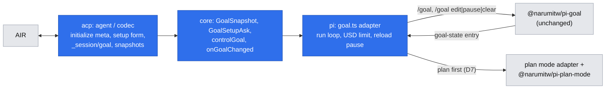
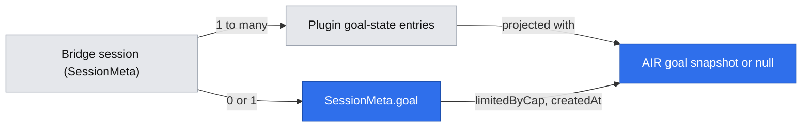

# Goal setup, state, and control
Status: approved

## 📝 TLDR

**Future behaviour.** In AIR, a user who sends `/goal <objective>` gets Junie's Goal Mode setup form. After it is
accepted, the agent keeps working on the objective over many turns without new prompts, and AIR shows a live goal
panel where the user can edit or clear the goal. Today the bridge has no goal at all: `_session/goal` answers
`-32601` (`packages/bridge/test/driver.test.ts:462-464`). The goal engine comes from the Pi plugin
`@narumitw/pi-goal` (unchanged). The bridge drives it the way it drives `@narumitw/pi-plan-mode`, and adds what only
the bridge can do: the setup form, the USD limit, the mapping to AIR's goal panel and the `_session/goal` control.

## 📝 Type of change

**Adopted Pi plugin**: `@narumitw/pi-goal` 0.55.5 (MIT) runs unchanged. The bridge detects it, drives it with its
commands and maps its saved state to AIR (option 2 of the reuse decision, chosen by the owner on 2026-11-25). An
upstream request to the plugin's author is an optional side task (option 4). It is not part of this change.

## 📝 Source of behaviour

- **Goal engine** (continuing over turns, token and time accounting, completion, pause and clear): the plugin
  `@narumitw/pi-goal` 0.55.5.
- **Plan review before the goal:** the plugin already supported, `@narumitw/pi-plan-mode`, through the bridge's
  existing review path.
- **Bridge code:** the setup form, eligibility, mapping the form's Brave choice, the USD limit, the ACP metadata,
  the goal snapshots, `_session/goal`, and the handling of reload and fork.
- **Pi core:** sessions, custom entries, follow-up messages.

## 📝 Problem Statement

AIR has a Goal Mode for large, long-running tasks ("port a product to an alternative technology"). Junie supports
it in ACP v1. A pi-junie user in AIR can only send single prompts: there is no setup form, no continuation across
turns and no goal panel. The feature map marks it "Not yet; plugin + mapping" (`docs/air-pi-feature-map.md`,
row Goal mode).

## 📝 Wire contract

**Source:** `docs/acp-air-communication.md`, section "Goal setup, state, and control" (lines 751-960). It was
written from Junie's and AIR's sources (`GoalExtension.kt`, `GoalSetupForm.kt`, `GoalHandler.kt`,
`SessionMetadataMapper.kt`, …).

**No recording yet.** `acp-examples/` is missing in this checkout, and neither fixture
(`junie-hello.json`, `junie-multi-session.json`) contains a goal. Task 1 of the implementation plan is the owner's:
record Junie's goal flow in AIR. Until that recording exists, the messages below come from the reference document.
Where the recording differs, the recording wins and this section is corrected in the implementation branch.

ACP v1 only. ACP v2 (`session/set_config_option` with `mode=goal`) is out of scope.

1. **Initialize.** The bridge answers `initialize` with the same object at two paths, `result._meta.goal` and
   `result._meta.jetbrains.air.goal`:

   ```json
   {"version": 1, "controlMethod": "_session/goal", "actions": ["set", "clear"]}
   ```

   - It sends the object only when the plugin is detected at a supported version and the client advertises
     `clientCapabilities.elicitation.form`.
   - The object is not a string in `capabilities[]`, and the existing metadata (`steering`,
     `jetbrains.air.version`, `capabilities`) stays as it is.
2. **Start.** AIR sends `session/prompt` with the text `/goal <objective>`. The objective comes only from this
   prompt.
3. **Setup form.** The bridge sends `elicitation/create` with `mode: "form"`:
   - **Message:** Junie's wording, verbatim from the reference.
   - **`requestedSchema`:** title `Configure Goal Mode`, with these properties:
     - `maxSessionCostUsd`: number, minimum 1, optional;
     - `braveMode`: string, `oneOf` `auto` ("Auto") / `on` ("On"), default `auto`;
     - `interactivePlan`: boolean, default false, present only when plan review is offered (see "Plan review
       first").
   - **`required`:** `["braveMode", "interactivePlan"]`, or `["braveMode"]` when `interactivePlan` is absent.
   - **The answer:** `{action: "accept", content}`, `{action: "decline"}` or `{action: "cancel"}`.
4. **Snapshot.** The bridge sends a `session/update` with
   `{sessionUpdate: "session_info_update", _meta: {goal: S, jetbrains: {air: {goal: S}}}}`, where S is one of:
   - `{objective, status, createdAt, updatedAt, timeUsedSeconds, tokensUsed, controlMethod: "_session/goal"}`,
     plus `tokenBudget` when it is finite;
   - `null`, which retracts the goal.

   Further rules:
   - `status` is one of `active`, `limited`, `complete`.
   - Timestamps are epoch milliseconds.
   - The client sends no reply.
5. **Control.** AIR sends `_session/goal` with `{sessionId, action: "set", objective}` or
   `{sessionId, action: "clear"}`. The result on success is `{}`. Errors:
   - `-32602`: unsupported action; blank or missing objective; `set` when no goal is active.
   - `-32002`: unknown or unloaded session, with the `session_not_loaded` shape used elsewhere in the bridge.
   - A successful `set` confirms only that the request was handled. The next snapshot confirms the new objective.
   - `clear` with no goal is a success.

## 📝 Reuse decision

### Requirements

R1 to R13 are what a plugin could provide; R14 to R17 are always bridge work.

| # | Requirement |
| --- | --- |
| R1 | Start a goal from bridge code with an objective string, with no UI dialog |
| R2 | Continue autonomously across turns until done, headless |
| R3 | Readable state: objective, status, created/updated time, time used, tokens used, optional token budget |
| R4 | Statuses that map to active / limited / complete |
| R5 | A notification on state change (for live snapshots) |
| R6 | Replace the objective of an active goal headless, without a user prompt |
| R7 | Clear headless, idempotent, stopping queued continuations |
| R8 | Stop at a limit and report "limited"; AIR's limit is USD |
| R9 | Optional plan review before the goal starts, composed with `@narumitw/pi-plan-mode` |
| R10 | Saved in the session; reopening a chat starts no work |
| R11 | Core function without Pi's terminal UI |
| R12 | A tool with which the model marks the goal complete; goal bookkeeping identifiable |
| R13 | Clean to load and disable; no effect when no goal exists |
| R14 | Setup form and its validation |
| R15 | Eligibility: Eco off, not Junie Lite, the client has form elicitation |
| R16 | Brave choice → the bridge's approval modes |
| R17 | ACP metadata, snapshots, `_session/goal` |

### Candidates

Searches: `npm search "keywords:pi-package goal"`, `"keywords:pi-package objective"`, `"pi goal mode"`,
`"pi-extension goal"` (2026-11-25). About 30 goal packages exist. The three below are the ones with real use
and a single-objective model. Weekly downloads are for the week up to 2026-11-24.

| Package | Version | Licence | Downloads/week | Published | Notes |
| --- | --- | --- | --- | --- | --- |
| `@narumitw/pi-goal` | 0.55.5 | MIT | 7,145 | 2026-11-25 | Same author as our plan mode; depends on `@narumitw/pi-tui-kit` ^0.71 |
| `pi-codex-goal` | 0.7.11 | MIT | 1,298 | 2026-11-21 | No dependencies; declares Node `>=24.22.3 <25 \|\| >=26.13.1` (policy, not an API need) |
| `pi-goal-x` | 0.35.1 | MIT | 8,400 | 2026-11-24 | About 19k lines; goals stored as files in the project; drafting dialogue |

Rejected without a source check:
- `@agimon-ai/po-goal`, 4.5k/week, because of its BUSL-1.1 licence.
- The rest, for having under 1k downloads a week or being forks of the three above.

### Coverage, from the source (plugin-check, tarballs read on 2026-11-25)

Paths are inside each package.

| # | `@narumitw/pi-goal` 0.55.5 | `pi-codex-goal` 0.7.11 | `pi-goal-x` 0.35.1 |
| --- | --- | --- | --- |
| R1 | covered: `/goal <obj>`, `src/command-registration.ts:622-683`, `src/commands.ts:37-102`; replacing an existing goal asks `ui.confirm` (`commands.ts:59`), which is false headless | covered: `src/commands.ts:85-113` | covered: `/goal-direct`, `goal-commands.ts:218-235` |
| R2 | covered: `lifecycle.ts:627,643`, `runtime.ts:539`; safety pause after 25 automatic turns or 3 without progress (`settings.ts:24,434`) | covered: `continuation-scheduler.ts:187-205` | covered: `goal-events.ts:582-610` |
| R3 | covered: entry `goal-state`, `persistence.ts:14-32`, `runtime.ts:1391`; tokens are `totalTokens` including cache (`accounting.ts:338-349`) | covered: `types.ts:11-21`; seconds; saved about every 60 s | covered: `goal-record.ts:35-63`, but stored in `<cwd>/.pi/goals/*.md` |
| R4 | covered: `prompts.ts:4`: active, paused, blocked, usage_limited, budget_limited, complete | covered: `types.ts:4` | covered: `goal-record.ts:2` |
| R5 | partial: the private sink `runtime.ts:347` is not exported; we re-read the entry after events | gap | gap |
| R6 | covered: `/goal edit`, `commands.ts:341-452` (new goal id, hidden "objective updated" prompt `:410`); refuses `budget_limited` (`:351-362`) | gap: refused headless, `commands.ts:92-94` | gap |
| R7 | covered: `/goal clear`, `commands.ts:318-339`, `runtime.ts:1414-1429`; does not stop the running turn, but `/goal pause` does (`runtime.ts:718`) | covered | gap: needs UI, `goal-commands.ts:405` |
| R8 | partial: token budget only (`runtime.ts:886-900`); no external hook | gap | gap |
| R9 | gap, but it shares the mutex `workflow:mutex:v1` with plan mode (`workflow-mutex.ts:3-4`): a goal refuses to start while plan mode is on (`commands.ts:78,455`) | gap | gap, conflicts |
| R10 | covered: restored at `lifecycle.ts:74,90-131`, with no prompt on reload; a pending `goal_wait` timer re-arms (`:130`) | gap: resumes on `session_start` | partial |
| R11 | covered: menus are TUI-only, `notify`/`setStatus` are no-ops | covered | partial |
| R12 | covered: `goal_complete`, `goal_blocked`, `goal_wait`, `tools.ts:63-348`, names `tool-policy.ts:3-6` | covered | covered, but its auditor runs `bash` in its own session outside the bridge's gate (`goal-auditor.ts:284-300`) |
| R13 | covered: 3 tools always registered; inert without a goal (`runtime.ts:1150-1155`); goal refuses to start if its tools are inactive (`tool-policy.ts:14-19`) | covered | gap |
| | **10 of 13, 2 partial** | 8 of 13 | 5 of 13 |

R14 to R17 are bridge work with every candidate.

Pi compatibility:
- `@narumitw/pi-goal`:
  - Its peers are `"*"` and it was developed against Pi 1.6.0. Every hook it uses exists in the bridge's Pi
    1.5.2 types; this was checked by searching the types, not by running it.
  - It imports `@narumitw/pi-tui-kit` at load time (`dist/index.ts:1377-1382`), so that package must resolve even
    headless. That is a second copy beside plan mode's ^0.70.
- `pi-codex-goal` compiles against the 1.5.2 types.

### Options

1. **The plugin's own settings.** Rejected: no candidate has a USD limit, a setup form or an ACP shape.
2. **Adopt `@narumitw/pi-goal` as it is; the bridge converts. Chosen.**
   - **How:** the bridge sends `/goal`, `/goal edit`, `/goal pause` and `/goal clear`, as the plan-mode adapter
     does. It reads the `goal-state` entry for snapshots.
   - **The USD limit:** the bridge enforces it by pausing the goal and keeps its own marker so that it can report
     `limited`. That is honest, because the limit belongs to the bridge; no unit is converted.
   - **Pros:** the most coverage, a lock shared with our plan mode, no copied code.
   - **Cons:**
     - a second `pi-tui-kit` copy;
     - `/goal edit` gives the goal a new id;
     - tokens include cache tokens;
     - the safety-pause defaults;
     - built against Pi 1.6.
   - **We take on:** a `src/pi/goal.ts` adapter of a few hundred lines and tests. When the plugin publishes a new
     version, we re-run the real-package test.
3. **An add-on package beside the plugin.** Rejected: the missing parts (a USD limit from the bridge's cost
   accounting, the ACP mapping) are bridge concerns with no use in plain Pi.
4. **A change upstream.** Optional, not blocking: ask the author for a public state-change event and a hook that
   lets outside code set `budget_limited`. Until then the bridge re-reads the entry and pauses at the limit. The
   owner sends the request; this repository has no tracker access.
5. **A local copy we alter.** Rejected: about 7k lines of source plus 5k of bundled `dist`, frequent releases,
   and no change to the plugin is needed.
6. **Our own plugin modelled on these.** Not chosen. Realistically 5-7k lines (each candidate's size). We would own
   continuation, compaction, accounting and recovery, which are the hard parts.
7. **Build nothing.** The user loses the goal panel and autonomous work across turns. Ordinary chats are
   unaffected.

`pi-codex-goal` was rejected because it refuses a headless edit (R6) and resumes work on reload (R10). `pi-goal-x`
was rejected for R7 and R13, because it stores goals as project files, and because its auditor runs ungated `bash`.

### Challenger (fresh sub-agent, 2026-11-25)

- **CRITICAL.** R4 is not covered as first claimed. The plugin's `paused` and `blocked` have no AIR status.
  Its default safety pause hits early, a pause at the USD limit would look the same as any other pause, and a
  `/goal resume` typed in AIR would get past the limit.
  → Resolved by the owner: decisions D2, D3 and D4 below.
- **WARNING.** `/goal clear` does not stop the running turn. → Clear is pause, then clear (see Control).
- **WARNING.** On reload, the `goal_wait` timer re-arms. → The bridge pauses the goal right after it creates the
  Pi session, before any prompt runs. A test covers this ordering.
- **WARNING.** `/goal edit` while the agent is busy is queued as a follow-up, and it refuses a `budget_limited`
  goal.
  → `set` returns `{}` once the edit is queued, and the snapshot confirms it later. A limited goal is not active,
  so `set` returns `-32602`.
- **WARNING.** A `/goal …` typed in AIR would bypass the bridge. → The bridge intercepts every `/goal` prompt (D4).
- **WARNING.** Plan review followed by the goal could end up with two drivers. → Approval leaves plan mode with
  `/plan exit`, never `/plan implement`, and then starts the goal.
- **WARNING.** A snapshot is fresh only after events, so `timeUsedSeconds` freezes during a long tool call.
  → Accepted as a known limit.
- **WARNING.** Option 6 was underpriced. → Corrected above.

### Decision

The owner chose **option 2** on 2026-11-25, with the recommendations D1 to D12 below.

## 📝 Decisions (owner, 2026-11-25)

| # | Decision |
| --- | --- |
| D1 | Adopt `@narumitw/pi-goal` unchanged (validated range, D13); type Adopted Pi plugin; the upstream request is optional |
| D2 | Status mapping: plugin `active` → `active`; `budget_limited` and `usage_limited` → `limited`; a pause at the bridge's USD limit → `limited` (bridge marker, survives reload); `complete` → `complete`; `paused` and `blocked` (including the safety pause) → retract (`null`) with a chat message giving the reason |
| D3 | Keep the plugin's safety-pause defaults (25 automatic turns, 3 without progress); revisit after the AIR test |
| D4 | The bridge handles every `/goal …` prompt as a new goal through the setup form; the plugin's `pause`, `resume`, `edit` and `clear` subcommands are not exposed to the user; AIR edits and clears only through `_session/goal` |
| D5 | The USD limit counts the whole session's cost (including what was spent before the goal), is checked after every model response, and pauses the goal when reached; it is not a hard billing ceiling (a request already running can go over) |
| D6 | Reopening, resuming or forking a chat whose goal was unfinished pauses the goal before any work and retracts it in AIR; a chat note says `/goal` starts a new one |
| D7 | `interactivePlan` is offered only when `@narumitw/pi-plan-mode` is installed. Flow: plan mode with the objective, then AIR's plan review. Approve: `/plan exit`, then start the goal. Revise: keep planning, the goal stays pending. Reject: no goal |
| D8 | Eligible: every model except Junie Lite, with Eco off, on a client that advertises form elicitation; otherwise `/goal` answers with the reason |
| D9 | `braveMode: auto` → approval mode `auto`, `on` → `brave`, while the goal runs; the previous mode comes back when the goal ends, unless the user changed it meanwhile |
| D10 | `set` during a running turn returns `{}` at once; the new objective applies from the next turn, and a snapshot confirms it |
| D11 | Task 1 is the owner's recording of Junie's goal flow in AIR |
| D12 | ACP v2 (`mode=goal`) is out of scope |
| D13 | Goal is available only for plugin versions the real-package test has passed: a validated range, at first `>=0.55.5 <0.56.0`. A newer plugin version leaves goal off (welcome message names the validated range) until the test passes on it and the range is raised (owner, after audit 1) |

## 📝 Proposed Solution

### Detection, loading, availability

- **Detection** (`src/pi/plugins.ts`):
  - Add `GOAL_PLUGIN = "@narumitw/pi-goal"` to `KNOWN_PLUGINS`, so it is found where `pi install npm:…` puts it.
  - Skip it when it is switched off (`extensions: []` / `/plugins off`, `PI_AIR_PLUGINS=0`), as for the other
    plugins.
  - Its tools `goal_complete`, `goal_blocked` and `goal_wait` join the active tool list when it is detected
    (`pluginTools`). The plugin refuses to start a goal without them (`tool-policy.ts:14-19`).
- **Availability:** goal is available only when every one of these holds:
  - the plugin is detected at a version inside the validated range (D13; a structured rule in
    `src/compat/features.ts`, see Layers);
  - its load check passed (next point);
  - the client advertised `elicitation.form` at initialize.

  Only then do `initialize`, the command list (`goal`) and the `_session/goal` method exist. When goal is
  unavailable, `_session/goal` keeps answering `-32601`, and `/goal` text is passed on as an ordinary prompt
  (today's behaviour). The same result decides the active tools, the command and the welcome line, so they never
  disagree.
- **Load check before the first advertisement.** `initialize` today reads only the detected manifests
  (`agent.ts:170-192`, `backend.ts:536-538`); extensions load later, per session. So the bridge loads the plugin
  once when the backend starts (`PiBackend.create`), before any `initialize` is answered:
  - It uses the same Pi extension loader that `createPiSession` uses, on the plugin's path.
  - It checks that the `goal` command and the tools `goal_complete`, `goal_blocked` and `goal_wait` are
    registered.
  - A throw, a missing dependency (such as `pi-tui-kit`) or a missing registration marks goal unavailable. This is
    logged with the reason and shown in the welcome message.

  The result crosses to ACP as neutral data: `AgentBackend.goalAvailable(): boolean` in `core/ports.ts`. Phase 1,
  step 3 confirms the loader can be called this way under Pi 1.5.2. If it cannot, availability stays off and the
  spec comes back to the writer.
- **A later load failure in one session** (the check passed, but this session's load threw): ordinary chat in that
  session keeps working. Goal is marked off for that session only:
  - `/goal` answers "Goal mode could not be loaded in this chat" with the logged reason;
  - `_session/goal set` answers `-32602`, because no goal is active;
  - `clear` answers `{}`.

  The initialize already sent is not withdrawn: ACP has no message for that. Each session that cannot run a goal
  says so itself.
- **Welcome:** the welcome message gets a "Goal mode" line, as `line("Plan mode", …)` has, with the install
  command when the plugin is missing.

### Starting a goal (`/goal <objective>`)

The command is handled in `runPrompt` beside `/plan`, `/compact` and `/stats`. The plugin's own `/goal` is never
reached by user text.

1. **Checks.** Each check that fails ends the turn with a chat message and `end_turn`, and starts nothing:
   - The objective is not blank.
   - The model is not Junie Lite and Eco is not active (`ecoActive()`).
   - No goal is active or waiting for plan review. If one is, the message is "a goal is already running (or
     waiting for plan review); clear it first".
   - When a limit is set later, the session's cost is below it.
2. **Setup form** through a new `GoalSetupAsk` port (see Layers). `interactivePlan` is included only when the plan
   mode plugin is available (D7).
   - Decline, cancel, a cancelled turn, or a form that fails all start nothing: no plugin command, no change of
     approval mode, `end_turn` (`cancelled` when the turn was cancelled).
   - The bridge validates the answer:
     - `braveMode` must be `auto` or `on`;
     - `maxSessionCostUsd`, when present, must be a finite number of at least 1;
     - `interactivePlan`, when present, must be a boolean.

     An invalid answer is treated as a decline, with a chat message.
3. **Accept.** Done in this order:
   - **Re-check:** the checks of step 1 and the USD limit are checked again.
   - **Clear the retained old goal.** The plugin keeps a goal that is paused, blocked or limited (by budget,
     usage or the USD limit), or one left from a reopened chat. Its `/goal <objective>` would then ask `ui.confirm`,
     which is false headless. So the bridge first sends `/goal clear` when the plugin's state shows such a goal.
   - **Fresh markers:** `meta.goal` is replaced by a fresh record, with no `limitedByCap` and no old `createdAt`
     (see Data Model).
   - **Approval mode:** the current one is remembered, and the session switches to `auto` or `brave` (D9, through
     the existing `selectApprovalMode`; AIR gets `settings_changed`).

   A declined or cancelled form changes none of this: the old plugin state stays as it was.
   - With `interactivePlan`: the plan step runs first (see "Plan review first").
   - Otherwise it sends `pi.prompt("/goal <objective>")`, with a helper like `runPlanCommand` that waits for the
     run the command starts.
4. **The goal run.** The initiating `session/prompt` stays open while the goal is `active`. That includes the
   plugin's continuations: they run in the same Pi session with the same subscription (transcript, permission
   gate, subagents, usage). The bridge waits between runs in the same way as `drainSteering`. The prompt resolves
   once:
   - **complete:** the last snapshot is `complete`; `end_turn`.
   - **limited:** by budget, usage or the USD limit; the last snapshot is `limited`; `end_turn`.
   - **paused or blocked by the plugin** (including the safety pause): snapshot `null`, a chat message with the
     reason from the entry (`pauseReason`/`blockedReason`), `end_turn`.
   - **cleared** through `_session/goal clear`: snapshot `null`, `end_turn`.
   - **cancelled** (`session/cancel`): the bridge sends `/goal pause`, which aborts the turn; snapshot `null`;
     `cancelled`.
   - **a model or provider error:** the bridge makes sure the goal is paused, sends `null`, and returns the
     existing typed failure.

   In every case the approval mode is restored (D9) and `meta.goal` is closed. There is exactly one prompt result.
   - **Waiting:** a goal waiting on `goal_wait` keeps the prompt open until its timer fires a continuation.

### Plan review first (`interactivePlan: true`)

The plugin will not start while plan mode holds the shared mutex, so the steps happen in sequence:

1. Switch plan mode on (`selectPlanMode(true)`), save the pending goal in `meta.goal` (`phase: "planning"`, with
   the `objective` from the `/goal` prompt), and run the objective as the planning task. The goal later starts with
   this saved objective, never with a revision message.
2. The plan is reviewed with the existing `reviewNewPlan` / `PlanReviewAsk`. For a pending goal, the decision is
   carried out differently:
   - **implement:** `/plan exit`, then `/goal <objective>`. The approved plan stays in the conversation as context.
     Then the goal run as above.
   - **revise:** the prompt ends; the goal stays pending. The user's next message revises the plan, and the next
     approval starts the goal.
   - **exit:** the pending goal is dropped, the approval mode is restored, and no goal starts.
3. **Before the goal starts** (implement), the checks of step 1 and the USD limit are checked again. If one fails:
   no goal, a message, the pending goal is dropped and the approval mode is restored.
4. **Ending a pending goal.** A pending goal never outlives its plan review. Each of these drops it (`meta.goal`
   closed) and restores the approval mode:
   - `_session/goal clear` (`{}`);
   - plan mode switched off by the user (`/plan off`, AIR's mode option);
   - a cancel or a provider error during planning;
   - reopening the chat (D6).

   While a goal is pending, `set` returns `-32602`, because no goal is active, and another `/goal` is refused (step
   1).

### Snapshots

- **Reading the state, entry by entry.** Pi emits `entry_appended` for every entry an extension appends
  (`pi-coding-agent/dist/core/agent-session.js:2879-2885`).
  - The bridge subscribes to it on the session's Pi `AgentSession` for its whole life, not only during a prompt,
    and processes every `goal-state` entry in order.
  - So a `complete` entry followed at once by its clear entry (both inside one `goal_complete` call) is seen, not
    skipped.
  - On creating or reopening the Pi session, the bridge reads the last `goal-state` entry on the branch once (as
    `readPlanModeState` does), to know the current state.
  - A snapshot goes out only when the projection changed.
- **Mapping to AIR's fields:**

  | AIR field | From the plugin's `ActiveGoal` |
  | --- | --- |
  | `objective` | `text` |
  | `status` | mapped per D2 |
  | `createdAt` | `startedAt` |
  | `updatedAt` | `updatedAt` |
  | `timeUsedSeconds` | `timeUsedSeconds` |
  | `tokensUsed` | `tokensUsed` |
  | `tokenBudget` | `tokenBudget`, only when finite and positive |
  | `controlMethod` | `"_session/goal"` |

  - **Timestamps:** the plugin's timestamp unit is not verified. They are converted to epoch milliseconds, and the
    real-package test settles the unit.
  - **Non-finite numbers:** a NaN or infinite counter drops the snapshot (logged); a zero is never invented.
- **Complete, then cleared by the plugin.** A `complete` goal is saved and then cleared immediately
  (`tools.ts:167-173`). The bridge publishes `complete` from the first entry and records `phase: "ended"` with
  `completed: true` in `meta.goal`.
  - A plugin clear entry that follows a `complete` does not retract it.
  - The `complete` snapshot stays until a new goal starts, AIR sends `_session/goal clear` (then `null`), or the
    session is reopened.
  - Only an explicit AIR clear, a new goal or reopening retracts a `complete`.
- **The USD-limit marker.** When `meta.goal.limitedByCap` is set and the plugin says `paused`, the projection is
  `limited`.
- **Outside a turn.** Snapshots sent after `_session/goal` while no turn runs go out through a new backend-session
  listener (see Layers). They are not tied to a prompt's sink.

### Control (`_session/goal`)

- **`set`:**
  - Validation: `objective` must be a non-blank string within the plugin's length limit (to be checked in the
    source at implementation time), and the projection must be `active`. Otherwise `-32602`, with no change.
  - It sends `/goal edit <objective>` and returns `{}` once the plugin accepted it, or once the edit was queued
    because the agent is busy (D10).
  - The snapshot after the next state read confirms it. The plugin's new goal id resets nothing AIR sees except
    `updatedAt`. If `createdAt` changes too, the bridge keeps the first `createdAt` of the goal run.
- **`clear`:**
  - If a goal is running: `/goal pause` (aborts the running turn), then `/goal clear`. Snapshot `null`, the open
    goal prompt resolves `end_turn`, and the approval mode is restored. File changes are not rolled back.
  - With no goal, a `complete` goal or a pending goal: `{}`, without sending `/goal clear` again; any visible
    snapshot is retracted with `null`. This is idempotent.
- **Errors:** a session that is unknown or not loaded in this process gets `-32002`. Any other action, including
  `pause` and `resume`, gets `-32602`.

### USD limit (D5)

- **Measure:** the session's accumulated cost is `usage.total.cost` from the same `SessionUsage` the bridge
  already builds (`this.usage(…)`, `backend.ts:1343`; it includes Junie Cost's summaries). It is updated at every
  assistant `message_end`. In a new chat it is a known 0.
  - It is not `meta.costUsd` / `reportedCost()`: that is the display value, which stays undefined until the cost
    is positive (`packages/junie-config/src/usage.ts:106-108`, Junie's AcpCostPolicy).
  - The display policy does not change.
- **When it is reached:** after each update, if a limit is set and `costUsd >= maxSessionCostUsd`, the bridge sets
  `meta.goal.limitedByCap`, sends `/goal pause` (which stops the run and the queued continuations), and publishes
  `limited`. The prompt resolves `end_turn`.
- **Before the start:** a session already at or above the limit gets a refusal message at setup acceptance, and no
  goal starts.
- **A model without prices:** the model's resolved price rates (Pi `model.cost`) are all zero, and it is not a
  free model whose usage is counted as free. Such a model cannot be held to a limit, so a setup with a limit on it
  is refused with a message. Without a limit it starts. A priced model in a new chat is accepted with a limit.
- **Not a hard ceiling:** a request already running finishes and can go over the limit. The docs say so.

### Reload, resume, fork (D6)

- **On reopening:** a saved session whose last `goal-state` entry is unfinished (active or waiting) gets a
  `/goal pause` right after the bridge creates its Pi session (`createPiSession`, which runs lazily at the first
  prompt). This happens before the user's prompt is sent.
  - **The audit's point:** `createPiSession` binds extensions and emits `session_start` before it returns, so a
    `goal_wait` timer that is already due could fire first.
  - **The fix: run authorisation, not request ownership.** An open ACP request does not allow a Pi run: the first
    prompt after reopening is itself open while `createPiSession` runs (`backend.ts:1174-1180, 1281-1284,
    729-731`). So the session keeps one flag of its own, `runsAllowed`:
    - **Closed from the start.** The flag starts closed, and the guard is subscribed before `bindExtensions()`.
      While it is closed, every `agent_start` is aborted at once, even with an ACP prompt open. Model requests are
      also refused at the provider boundary (the bridge's `before_provider_request` / stream hook returns an abort),
      so an aborted run never reaches the model.
    - **Recovery while closed.** After binding, the bridge reads the restored goal state. If it is unfinished, the
      bridge sends `/goal pause` and waits until any aborted run has ended (`agent_end`), all with the flag still
      closed.
    - **Opened explicitly.** Only after that does the bridge open the flag, and only for:
      - the run it starts for the user's prompt;
      - the continuations of a goal accepted in this process (its own goal run).
    - **Between those**, for example a plugin follow-up after the bridge's goal run ended, the flag is closed
      again. A plugin run is never allowed just because some other request is open.
  - The real-package test covers an already-due timer (Phase 1, step 3). The stand-in test reproduces the ordering
    deterministically (see First test).
- **What AIR sees:** on `session/load`/`session/resume` of such a session, the bridge sends a `null` snapshot and
  a one-line chat note: the earlier goal was stopped, and `/goal` starts a new one. A complete goal is not
  re-published.
- **Fork:** a forked session copies the conversation, including the `goal-state` entries, but not `meta.goal`. It
  is handled like a reload: paused, with no goal in AIR.
- **Approval mode, without depending on the plugin.** A goal-raised approval mode must never outlive its goal.
  The approval mode a goal did not raise is called below the mode before the goal:
  - if `meta.goal` is not ended, has `previousApprovalMode` and has no `approvalChangedByUser`, it is
    `previousApprovalMode`;
  - otherwise it is `approvalMode`.

  Where it applies:
  - **Reopening** (load, resume, the first prompt after a restart): the bridge sets the session's `approvalMode`
    to the mode before the goal and closes `meta.goal`. This runs whether or not goal is available: plugin
    removed, switched off, failed to load, or outside the validated range. Only after that is `meta.goal`
    ignored.
  - **Fork:** `forkSession` (`backend.ts:579-612`, which copies `source.approvalMode` today) copies the mode
    before the goal instead, so a fork of a Brave goal started from a Safe session is Safe.

### Tool rows and hidden messages

- **Tool rows:**
  - Successful `goal_complete` and `goal_wait` rows are not shown; the snapshot shows the effect.
  - `goal_blocked` and every failed goal tool row stay visible.
  - Edit, bash and other work rows are never hidden.
- **Hidden messages:** the plugin's continuation and "objective updated" prompts are user messages sent with
  `sendUserMessage`. The bridge must recognise them, by the plugin's marker text or custom type (to be confirmed
  in the source at implementation time), and leave them out of the live transcript and of `history()` replay.
  The `goal-contract` custom message (`display:false`) is already not shown.

### Settings that change while a goal runs

While a goal is `active`, the bridge refuses with a clear error to select Junie Lite, to switch Eco on, or to pick
a Default level that turns Eco on. Changing the approval mode is allowed; it cancels the restore at the end (D9).

## 📝 Architecture and layers touched

- **core** (`types.ts`, `ports.ts`):
  - neutral types `GoalSnapshot` (the fields above; status `active | limited | complete`), `GoalSetupForm`
    (`offerPlan: boolean`) and `GoalSetupAnswer` (`accept` with
    `{braveMode: "auto" | "on", maxSessionCostUsd?: number, interactivePlan?: boolean}`, `decline`, `cancel`);
  - the port `GoalSetupAsk = (form, signal) => Promise<GoalSetupAnswer>`, which is the setup step on
    `BackendSession.prompt` (alongside `askUser` and `reviewPlan`). A separate port, because `QuestionForm` only
    carries string choices and could not validate a number or a boolean;
  - on `BackendSession`, optional: `goal(): GoalSnapshot | null | undefined`,
    `controlGoal(action: {kind: "set"; objective: string} | {kind: "clear"}): Promise<void>` (it throws a typed
    `GoalControlError` with reason `invalid` or `inactive`) and `onGoalChanged(listener): () => void`;
  - the `TurnEvent` kind `goal` (snapshot or null).
- **acp** (`agent.ts`, `codec.ts`, `wire.ts`):
  - the initialize metadata at both paths, only when the backend reports goal available and the client has form
    elicitation;
  - the setup form's encoding and decoding, with the exact schema above;
  - the `goal` event → `session_info_update` with both `_meta` paths;
  - dispatch of `_session/goal`, with the error codes above;
  - the out-of-turn snapshot listener per loaded session.
- **pi** (new `src/pi/goal.ts`, `plugins.ts`, `backend.ts`, `session-store.ts`):
  - reading and mapping the entry;
  - the command helpers (`/goal`, `/goal edit`, `/goal pause`, `/goal clear`);
  - the goal run loop, the USD-limit check, the plan-first sequence, the pause on reopening, hiding the hidden
    messages, and `meta.goal`.
- **compat** (`features.ts`): a structured extension rule, separate from `AIR_FEATURE_RULES`. For example:

  ```ts
  GOAL_EXTENSION = { requires: [{ plugin: "@narumitw/pi-goal", minVersion: "0.55.5", belowVersion: "0.56.0" }] }
  ```

  This adds an optional exclusive upper bound, `belowVersion`, to `PluginRequirement`; existing rules are
  unaffected. It comes with a resolver that returns whether the rule is satisfied, and why not (shown in the
  welcome message). `belowVersion` is raised only together with a passing `goal-real.test.ts` on the new version
  (D13). It stays standalone, and nothing is added to
  `capabilities[]`.

`packages/bridge/test/architecture.test.ts` stays green:
- core imports only core;
- acp never imports Pi;
- pi never imports ACP;
- compat stays standalone.

`main.ts` stays the composition point.



Takeaway: the plugin is touched only through its commands and its saved entry. Everything AIR sees is bridge code
across the existing layers.

## 📝 Data Model

- **The plugin's `goal-state` custom entries** (existing; owned by the plugin) are the authority for the goal.
  The bridge never writes them.
- **`SessionMeta.goal`** (new, optional, in the bridge's session store):

  ```ts
  { phase: "planning" | "running" | "ended",
    objective?: string,        // only while phase is "planning": the objective to start after plan approval
    completed?: boolean,       // the run ended complete (keeps the complete snapshot)
    maxSessionCostUsd?: number,
    previousApprovalMode?: ApprovalMode,
    approvalChangedByUser?: boolean,
    limitedByCap?: boolean,
    createdAt?: number }
  ```

  - `createdAt` is the first `createdAt` of the goal run.
  - It is written at setup acceptance and on every change, and closed (`phase: "ended"`) at the end.
  - Sessions saved without it load as ordinary chats.
  - A fork does not copy it.
- **Privacy:** the objective is kept beside the transcript only while a plan is pending (`objective`, removed when
  the phase ends), in the same local state directory as the session's other metadata. Otherwise it stays only in
  the session transcript, as the user's prompt already does. No extra
  logging of the objective and no keys in any of this.



## 📝 Delta

### Capability: goal-setup-state-and-control

#### MODIFIED Requirement: Unknown extension methods
The bridge SHALL answer `_session/goal` with `-32601` when goal is unavailable, and SHALL handle it as the goal
control method when goal is available.

##### Scenario: Goal unavailable
- WHEN the plugin is absent, switched off, outside the validated range (`>=0.55.5 <0.56.0` at first) or fails its
  load check, or the client has no form elicitation
- THEN `initialize` has no `goal` metadata, `/goal` text is an ordinary prompt, and `_session/goal` answers `-32601`.

##### Scenario: Goal available
- WHEN the plugin is detected inside the validated range, its load check passed, and the client advertises form
  elicitation
- THEN `result._meta.goal` and `result._meta.jetbrains.air.goal` both equal
  `{version: 1, controlMethod: "_session/goal", actions: ["set", "clear"]}`.

Frozen by: `packages/bridge/test/driver.test.ts` ("unknown methods get -32601").

#### ADDED Requirement: Goal setup form
The bridge SHALL ask for Goal Mode settings with Junie's form before starting a goal, and SHALL start nothing
unless the form is accepted with valid content.

##### Scenario: Accept with defaults
- WHEN an eligible user sends `/goal Migrate the billing module.` and accepts `{braveMode: "auto"}` (with
  `interactivePlan: false` when offered)
- THEN the plugin gets `/goal Migrate the billing module.`, the approval mode becomes `auto`, and an `active`
  snapshot follows.

##### Scenario: Decline, cancel or invalid
- WHEN the form is declined or cancelled, the turn is cancelled during the form, or `maxSessionCostUsd` is below 1
  or not a number
- THEN no plugin command is sent, the approval mode is unchanged, and no snapshot is sent.

##### Scenario: Not eligible
- WHEN the model is Junie Lite or Eco is active, the objective is blank, or a goal is already running
- THEN no form is shown and the turn ends with a message giving the reason.

#### ADDED Requirement: Goal snapshots
The bridge SHALL publish the goal at both `_meta` paths of a `session_info_update`, with status `active`,
`limited` or `complete`, epoch-millisecond timestamps and real counters, and SHALL retract it with an explicit
`null` for every other end.

##### Scenario: Lifecycle
- WHEN the goal runs, reaches a budget or usage limit, the USD limit, or completes
- THEN AIR sees `active`, then `limited` or `complete`, and the initiating `session/prompt` resolves `end_turn`
  once.

##### Scenario: Plugin pause or block
- WHEN the plugin pauses (including its safety pause) or blocks the goal
- THEN both paths get `null`, a chat message gives the reason, and the prompt resolves `end_turn`.

#### ADDED Requirement: Goal control
The bridge SHALL handle `_session/goal` `set` and `clear` as controls, not as prompts.

##### Scenario: Set
- WHEN `set` has a non-blank objective and the goal is active
- THEN the result is `{}`, no user turn is added, and a later snapshot has the new objective.
- WHEN the objective is blank or missing, the goal is not active, or the action is not `set` or `clear`
- THEN the result is `-32602` and nothing changes.

##### Scenario: Clear
- WHEN `clear` arrives while a goal runs
- THEN the running turn stops, both paths get `null`, the open prompt resolves `end_turn`, the approval mode is
  restored, and no further goal request reaches the model.
- WHEN `clear` arrives again, or with no goal
- THEN the result is `{}`.

##### Scenario: Unknown session
- WHEN the session id is unknown or not loaded
- THEN the result is `-32002`.

#### ADDED Requirement: USD limit
The bridge SHALL stop a goal when the session's cost reaches the accepted `maxSessionCostUsd`.

##### Scenario: Reached during the run
- WHEN a model response brings the session's cost to or over the limit
- THEN no further continuation is dispatched, AIR sees `limited`, and the prompt resolves `end_turn`.

##### Scenario: Already reached
- WHEN the session's cost is already at or over the limit at acceptance, or the model reports no cost
- THEN no goal starts and a message gives the reason.

#### ADDED Requirement: Plan review before a goal
The bridge SHALL offer `interactivePlan` only when the plan mode plugin is available, and SHALL start the goal only
after the plan is approved.

##### Scenario: Approve, revise, exit
- WHEN the plan is approved
- THEN plan mode ends without its implement step and the goal starts.
- WHEN the user asks for a revision
- THEN the goal stays pending until a later approval.
- WHEN plan review is left with exit
- THEN no goal starts and the approval mode is restored.

#### ADDED Requirement: No goal work on reopening
The bridge SHALL NOT continue an unfinished goal when a chat is reopened, resumed or forked.

##### Scenario: Reload with an active goal
- WHEN a saved session with an active or waiting goal is loaded and the user sends a prompt
- THEN the bridge pauses the goal before that prompt runs, AIR has `null` at both paths, no continuation is sent,
  and a chat note says that `/goal` starts a new goal.

## 📝 Edge Cases & Failure Scenarios

| Case | What happens |
| --- | --- |
| The plugin is missing, or `pi-tui-kit` does not resolve | Goal is unavailable; ordinary chats and plan mode keep working; logged |
| Plugin version outside `>=0.55.5 <0.56.0` | Not advertised; the welcome message names the validated range |
| The plugin refuses `/goal` (mutex busy, tools inactive) | Detected by reading the state after the command: no goal started, a message, approval mode restored |
| Two sessions with goals | Each `BackendSession` has its own Pi session, entry and `meta.goal`; no shared state |
| `set` during a running turn | Queued by the plugin; `{}`; the new objective applies from the next turn (D10) |
| `clear` races a completion | Whatever the state read after `clear` finds wins. A `complete` already published stays until it is cleared. No later snapshot resurrects a cleared goal |
| Provider error mid-goal | Goal paused, `null`, the existing typed failure (`sessionFailure`) |
| The agent process quits mid-goal | On reopening: D6 |
| The user types `/goal pause` | Treated as a new goal with the objective "pause" (D4). While a goal runs it is refused with "clear it first"; otherwise it gets the setup form like any objective |
| A new `/goal` after a paused, blocked, limited, complete or reopened goal | After the form is accepted, the bridge clears the plugin's retained goal first, then starts the new one with fresh markers; no `ui.confirm` is needed |
| A plugin run the bridge has not allowed (a due timer during binding, even with a prompt open; a stray follow-up) | Aborted at `agent_start` and refused at the provider boundary while `runsAllowed` is closed; logged |
| The plugin is updated to a version outside the validated range | Goal off at the next agent start; the welcome names the validated range; saved goal metadata still restores the approval mode |
| Safety pause after 25 turns | `null`, plus a message saying that the plugin paused the goal and how to start again (D3) |

## 📝 Risks & Impact Review

- **Pi 1.6 versus 1.5.2:** the plugin was developed against Pi 1.6. The real-package test (Phase 2) is the gate:
  if it fails on 1.5.2, goal stays unavailable until the bridge's Pi is upgraded. That upgrade would be a
  separate spec.
- **The plugin's internals:** the bridge depends on its command syntax, the `goal-state` entry shape and its tool
  names. None of them is a declared API. So availability is a validated range (D13): the real-package test covers
  each point, and the upper bound is raised only after the test passed on the new version. The cost is that goal
  turns off after a plugin update until then. The welcome message says so.
- **Runaway work:** the plugin's safety pause (D3), the USD limit, cancel and clear all stop it. Reopening never
  continues (D6).
- **Not a hard billing ceiling:** documented in the bridge spec and the README.
- **Rollback:** uninstall or `/plugins off`, then restart. Goal is no longer advertised, and saved `goal-state`
  entries stay as inert history. `SessionMeta.goal` is ignored when goal is unavailable.

## 📝 Migration & Backward Compatibility

- **Goal unavailable** (plugin missing, switched off, outside the range, load check failed, or a client without
  forms): the wire and behaviour are exactly as today.
  - Same `initialize` metadata, with no `goal` keys.
  - `_session/goal` → `-32601`; `/goal` text is an ordinary prompt.
  - Same command list and tool list.
- **Initialize metadata:** the existing `steering`, `authStatus`, `jetbrains.air.version` and `capabilities` are
  unchanged. Goal adds two keys and nothing in `capabilities[]`.
- **Old sessions:** `SessionMeta.goal` is optional. Sessions saved before this change load as ordinary chats with
  their saved approval mode. No migration and no backfill.
- **Approval mode:** the restore on reopening and the fork rule depend only on `SessionMeta.goal`, never on the
  plugin (see "Reload, resume, fork").
- **Unchanged behaviour:** existing commands (`/plan`, `/compact`, `/stats`, skills), steering, plan review
  without a goal, `ask_user` forms, usage and cost reporting (`usage_update`, the session-list cost, the display
  policy of `reportedCost`), the fork of a session that never had a goal, and the unknown-method answer for every
  other method.
- **Core ports:** the new `BackendSession` members are optional, and `AgentBackend.goalAvailable` defaults to
  false. Other backends and test doubles compile unchanged.

## 📝 First test and acceptance checks

- **The first test:** `packages/bridge/test/goal.test.ts`, written before the implementation.
  - It runs the `MemoryWire` harness and `test/fake-proxy.ts` against a stand-in plugin written into a temporary
    Pi agent dir, as `test/plan-mode.test.ts` does.
  - The stand-in registers `/goal <obj>`, `/goal edit|pause|clear` and the tool `goal_complete`. It appends
    `goal-state` entries with the plugin's `ActiveGoal` fields, and sends follow-up continuations with
    `sendUserMessage` until `goal_complete`.
  - Once the owner's recording exists, it is extracted to the sanitised fixture `test/fixtures/junie-goal.json`,
    and the test asserts the recorded shapes.
- **Characterisation first:** `driver.test.ts` "unknown methods get -32601" stays as the unavailable case, run
  green before dispatch changes.
- **Cases `goal.test.ts` must cover:**
  - initialize metadata present or absent (plugin present, absent, switched off, too old, newer than the validated
    range, a manifest whose extension throws at load or misses a dependency; client with and without forms). In
    every absent case, ordinary chats still work;
  - the setup schema exactly, with and without `interactivePlan`;
  - accept, decline, cancel, an invalid answer, a cancel while the form is open;
  - eligibility refusals (Junie Lite, Eco, blank objective, a goal already running);
  - snapshots at both paths with mapped statuses;
  - `set` success and confirmation, and `set` errors (`-32602`, `-32002`);
  - `clear` while running (the turn stops, no further model request at the fake proxy) and `clear` repeated;
  - complete then cleared by the plugin inside one `goal_complete` call (both entries appended synchronously): AIR
    gets `complete`, later events do not retract it, and an explicit `clear` then sends `null`;
  - a new goal after a safety pause, a block, the USD limit, a budget or usage limit, and reopening: no
    `ui.confirm` needed, and no old `limitedByCap` or `createdAt` in the new run;
  - the USD limit reached mid-run and already reached; a first capped goal on a priced model in a new chat
    succeeds; a model without prices with a limit is refused; earlier positive spend counts;
  - a plugin pause or block → `null` plus a message;
  - plan first: approve, revise then approve (the goal starts with the original objective), exit; cancel, a
    provider error, `/plan off`, `clear` and reopening during planning leave no pending goal and no raised
    approval mode; the checks repeated before the start;
  - reload with an active goal → paused before the prompt, `null`, no continuation request; a plugin run with no
    owner is aborted;
  - **the open-prompt reload race.** A saved waiting goal is reopened by sending the first ordinary
    `session/prompt`. The stand-in fires its overdue timer (a continuation) during `session_start`, that is during
    extension binding while that request is open. Assertions:
    - the old goal causes zero model requests at the fake proxy;
    - it ends up paused;
    - the user's prompt then runs normally;
    - there is exactly one prompt result and no goal panel comes back;
  - fork;
  - approval-mode restore, and no restore after a change by the user; a fork of a Brave goal from a Safe session
    is Safe; reopening that session with the plugin removed or switched off is Safe again;
  - two sessions isolated;
  - hidden continuation messages absent from the live transcript and from `history()`;
  - exactly one `session/prompt` result per goal run.
- **The real package:** `packages/bridge/test/goal-real.test.ts`, opt-in with `PI_GOAL_AGENT_DIR` (as
  `plan-mode-real.test.ts` does with `PI_PLAN_MODE_AGENT_DIR`), against the fake proxy. It checks:
  - it loads under Pi 1.5.2, with `pi-tui-kit` resolving;
  - the command syntax and the entry fields, including the timestamp units;
  - the continuation markers;
  - edit while busy;
  - pause then clear stopping the turn;
  - the pause on reopening winning against the `goal_wait` timer, including one already due at `session_start`
    (the guard against runs with no owner);
  - `entry_appended` arriving for both entries of complete-then-clear;
  - the load check at backend start using Pi's extension loader;
  - the mutex with the real plan mode.
- **Unchanged:** `npm run check` and `npm test` pass with no network, no keys and no live model. The existing
  Default/Plan, `/compact`, steering, `ask_user`, session-list and cost tests stay green.

## 📝 Check in AIR

1. Install `pi install npm:@narumitw/pi-goal@0.55.5` and restart the dev agent. The welcome message lists Goal
   mode with its version.
2. Pick an eligible model (not Junie Lite, Eco off). Send `/goal Add a CONTRIBUTING.md with build and test steps`.
   The form "Configure Goal Mode" shows Brave Mode (Auto/On), an optional cost limit, and Interactive Plan if plan
   mode is installed. It has no objective field.
3. Decline the form: nothing runs and no goal panel appears. Send the goal again and accept Auto: the goal panel
   shows the objective as active, its counters grow, and the agent works over several turns without a new prompt.
   Permissions behave as in Auto.
4. Edit the objective in the goal panel: no new prompt appears in the chat, and the panel shows the new objective.
   Clear it: the work stops, and the panel disappears. Clear again: no error.
5. Start a goal with a cost limit just above the current session cost (minimum 1 USD). It stops at the limit and
   the panel shows limited. Let a small goal finish: the panel shows complete.
6. With plan mode installed, tick Interactive Plan: a read-only plan is reviewed first, and the goal starts only
   after Approve.
7. Restart the agent with a goal running and reopen the chat. No work starts, the panel is gone, and the chat says
   that `/goal` starts a new goal. Switch the plugin off and restart: the panel and `/goal` are gone, and ordinary
   chat and plan mode work.

## 📝 Docs to update

In the implementation change:
- `docs/air-pi-feature-map.md`: the Goal mode row and its notes (plugin version, what is done, the limits);
- `packages/bridge/docs/spec.md`: setup, snapshots, control, the USD limit and the fact that it is not a hard
  ceiling, reopening;
- `README.md`: the plugin list with the install command, and `/goal` usage;
- the welcome text.

## 📋 Implementation Plan

### Phase 1: Evidence

1. **Owner:** record Junie's v1 goal flow in AIR (setup accept and decline, a live edit, clear, a limit,
   completion, an error to `set`). The raw files stay in the git-ignored `acp-examples/`.
2. Extract the fixture:
   `node packages/bridge/scripts/extract-fixture.ts acp-examples/<session>/derived/acp-messages.jsonl junie-goal`.
   Check it for keys and home paths. Correct the Wire contract section where the recording differs.
3. Install `@narumitw/pi-goal@0.55.5` in a scratch agent dir and write `goal-real.test.ts`. Settle:
   - the timestamp units and the continuation markers;
   - the Pi 1.5.2 load and the load check through Pi's extension loader;
   - `entry_appended` for the plugin's entries;
   - an already-due `goal_wait` timer on reopening.

   If it does not load on 1.5.2, or the load check cannot be done before `initialize`, stop and report: goal stays
   unavailable.

### Phase 2: Tests and plumbing, goal not yet advertised

4. Run the characterisation test green (`driver.test.ts` -32601). Add `goal.test.ts` with the stand-in. It fails.
5. Core types and ports; acp encoding of the form and snapshots; `_session/goal` dispatch behind an availability
   flag that is still off. `architecture.test.ts` stays green.
6. `plugins.ts` detection, active tools and the welcome line; the structured rule in `compat/features.ts` with the
   validated range and its tests; the load check at backend start and `AgentBackend.goalAvailable()`.

### Phase 3: The goal lifecycle

7. `src/pi/goal.ts`: reading and mapping the state, the command helpers, `SessionMeta.goal`.
8. Start: the checks, the setup form, the approval-mode switch and restore, the goal run loop with exactly one
   prompt result, and the out-of-turn listener.
9. Control: `set`, `clear`, the error codes.
10. The USD limit; the plugin pause and block → `null` plus a message; error handling.
11. Plan first (D7).
12. Reopening, resume and fork pause (D6), the guard against runs with no owner, and the approval-mode restore that
    works without the plugin; hiding the hidden messages; refusing setting changes while a goal is active.
13. Turn availability on: initialize metadata, the `goal` command in the command list. Run every goal test,
    `goal-real.test.ts` and the full suite.

### Phase 4: Docs, review, hand test

14. Update the docs listed above.
15. `npm run check` and `npm test`; the opt-in real-package test on the dev machine; two reviews; the owner's
    Check in AIR.
16. Archive the Delta into `.ai/specs/capabilities/goal-setup-state-and-control.md`.
