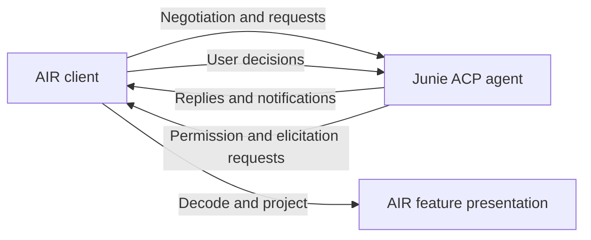

# AIR–Junie ACP communication reference

This reference describes the ACP features that the current AIR client and Junie agent can use together. It is organized by user-visible feature rather than by a list of extension names. The agent-side catalog remains in [ACP extensions](acp-extensions.md); [ACP steering](acp-steering.md) and [ACP goal extension](acp-goal-extension.md) remain the detailed contracts for those larger features.

## Scope and verification snapshot

The reference distinguishes standard ACP messages from JetBrains extension metadata and methods. A feature is marked **supported** only when current AIR sends or consumes the relevant contract as well as Junie implementing it. **Partial** means only a subset is interoperable or a concrete limitation remains. **Compatibility only** means an older contract remains in the current code, but current AIR negotiates a newer path or otherwise does not select it. **Current AIR does not negotiate** means Junie has an agent-side handler, but the current AIR client does not announce or use it. These are repository-evidence labels, not the result of a live AIR–Junie interoperability run.

Verification was performed on 2026-11-17 against Junie revision `b739bacc3da050c52b3f00c9cf75a61829973e70` and the read-only AIR checkout at `fb937c48917627fe45c3d210af65aab0ec729e4b`. The Junie checkout already had unrelated edits in `install_junie_local.ps1` and `install_junie_local.sh`; the AIR checkout already had an unrelated edit in `.idea/runConfigurations/IDEA__LLM_.xml`. Those files were not changed. The older reconciliation note in [the agent-side catalog](acp-extensions.md) predates these snapshots; when it disagrees with current source, this reference records the source behavior and the disagreement.

Paths in the evidence notes are relative to the owning checkout: Junie paths beginning `session/` or `commands/` are relative to `ej-app/cli-standalone/src/main/kotlin/com/intellij/ml/llm/matterhorn/ej/app/cli/standalone/acp/`; full Junie repo paths begin `ej-app/`; bare filenames name the exact class/test in its feature package. AIR implementation and test paths are relative to `ultimate/plugins/air/`; AIR spec paths are relative to `ultimate/plugins/air/spec/`. The verified AIR checkout was `<ultimate checkout>`.

## Interaction model

The diagram is only an orientation aid; the ordered message flows and JSON examples below are authoritative.



| Feature family | Feature | Current AIR ↔ Junie support |
|---|---|---|
| [Connection, configuration, and sessions](#connection-configuration-and-sessions) | [Initialize and identify the AIR client](#initialize-and-identify-the-air-client) | **Supported**, ACP v1 and v2. |
| [Connection, configuration, and sessions](#connection-configuration-and-sessions) | [Authentication choices and auth status](#authentication-choices-and-auth-status) | **Supported** for sign-in choices; status presentation is partial because Junie omits AIR’s initialize-time snapshot. |
| [Connection, configuration, and sessions](#connection-configuration-and-sessions) | [Provider model discovery and provider configuration](#provider-model-discovery-and-provider-configuration) | **Partial**; `_providers/models` is usable, v1 standard provider configuration is supported, but current Junie v2 and AIR do not share a provider-configuration path. |
| [Connection, configuration, and sessions](#connection-configuration-and-sessions) | [Session instructions](#session-instructions) | **Supported**, on `session/new` in ACP v1 and v2. |
| [Connection, configuration, and sessions](#connection-configuration-and-sessions) | [Additional skill roots](#additional-skill-roots) | **Partial**; roots are sent on lifecycle requests and prompts, while Junie resolves them at session open. |
| [Connection, configuration, and sessions](#connection-configuration-and-sessions) | [Session index, archive, rename, and delete](#session-index-archive-rename-and-delete) | **Partial**; v1 uses the negotiated AIR list/archive/rename contract, while v2 uses its standard cursor-paginated catalog and has no Junie archive/rename extension. |
| [Connection, configuration, and sessions](#connection-configuration-and-sessions) | [Session fork](#session-fork) | **Supported**, ACP v1 and v2; AIR’s message-specific fork point is optional metadata. |
| [Turn control and user interaction](#turn-control-and-user-interaction) | [Steering](#steering) | **Supported**; v1 uses `_session/steering`, while v2 gates standard `session/prompt` follow-ups and does not use the extension method. |
| [Turn control and user interaction](#turn-control-and-user-interaction) | [Goal setup, state, and control](#goal-setup-state-and-control) | **Partial** overall; setup works through forms in both versions, while Goal state/control is v1-only. |
| [Turn control and user interaction](#turn-control-and-user-interaction) | [Plans, plan review, and plan files](#plans-plan-review-and-plan-files) | **Partial**; base plan updates and permission reviews work, but file linkage is v1-only and Junie does not send AIR plan-content deltas. |
| [Turn control and user interaction](#turn-control-and-user-interaction) | [Permission requests and decisions](#permission-requests-and-decisions) | **Supported** as base ACP v1/v2; AIR-specific request presentation metadata is emitted by Junie v1 only. |
| [Turn control and user interaction](#turn-control-and-user-interaction) | [Elicitation forms and URL prompts](#elicitation-forms-and-url-prompts) | **Supported** for forms in v1/v2 and URL prompts in v2, subject to schema and user-action handling. |
| [Turn control and user interaction](#turn-control-and-user-interaction) | [Unattended interaction](#unattended-interaction) | **Current AIR does not negotiate** Junie’s `unattendedInteraction` metadata capability. |
| [Turn control and user interaction](#turn-control-and-user-interaction) | [Command and skill invocation](#command-and-skill-invocation) | **Partial**; AIR classifies `$` skill completions, but Junie omits live-session `kind` and `skillPath` decoration. |
| [Transcript and feature presentation](#transcript-and-feature-presentation) | [Native subagent sessions](#native-subagent-sessions) | **Partial**; live child streams interoperate in v1, but Junie v2 does not advertise the contract, replay restores summaries/lifecycle rather than full child history, and direct child prompts are read-only. |
| [Transcript and feature presentation](#transcript-and-feature-presentation) | [Legacy subagent transcript blocks](#legacy-subagent-transcript-blocks) | **Compatibility only**; the v1 block fallback remains for older/non-native peers, while current AIR negotiates native sessions. |
| [Transcript and feature presentation](#transcript-and-feature-presentation) | [Terminal output](#terminal-output) | **Supported**, using v1 metadata deltas or v2 standard terminal updates/chunks. |
| [Transcript and feature presentation](#transcript-and-feature-presentation) | [Message phases](#message-phases) | **Supported**; Junie sends AIR’s `commentary`/`final_answer` signal with a separate Junie metadata copy. |
| [Transcript and feature presentation](#transcript-and-feature-presentation) | [Skill and MCP tool presentation](#skill-and-mcp-tool-presentation) | **Supported**; AIR consumes Junie skill metadata and the MCP tool marker. |
| [Transcript and feature presentation](#transcript-and-feature-presentation) | [Context compaction](#context-compaction) | **Partial**; Junie emits explicit compaction events, but this does not establish automatic-compaction support. |
| [Transcript and feature presentation](#transcript-and-feature-presentation) | [Typed session failures](#typed-session-failures) | **Partial**; typed failure rows are sent on the negotiated v1 path; Junie v2 does not emit the typed record. |
| [Transcript and feature presentation](#transcript-and-feature-presentation) | [Changed-file reports](#changed-file-reports) | **Partial**; current AIR and Junie interoperate in v1, but Junie v2 omits the agent-side capability and all Junie reports declare coverage incomplete. |
| [Transcript and feature presentation](#transcript-and-feature-presentation) | [Prompt suggestions](#prompt-suggestions) | **Partial**; one-way session-info updates work in Junie v1, while the v2 presenter does not emit them. |
| [Transcript and feature presentation](#transcript-and-feature-presentation) | [Usage and cost](#usage-and-cost) | **Supported** when Junie emits cumulative usage; cost is optional. |

## Shared wire conventions

### ACP version and serialized capability paths

AIR supports ACP protocol versions 1 and 2 and selects the version negotiated by the agent. The SDK names are not the wire contract. In v1, initialize client identity and capabilities are serialized as `params.clientInfo` and `params.clientCapabilities`; in v2, the corresponding fields are `params.info` and `params.capabilities`. Thus AIR’s client extension envelope is `params.clientCapabilities._meta` in v1 and `params.capabilities._meta` in v2. Agent capabilities serialize under `result.agentCapabilities` in v1 and `result.capabilities` in v2. AIR-owned agent metadata remains at `result._meta`; for v2 session-scoped capability metadata the path is `result.capabilities.session._meta`. Do not move an extension into a capability object unless its contract says to do so.

For example, the Kotlin v1 `planCapabilities` property serializes as wire field `params.clientCapabilities.plan`; v2’s AIR client capability model does not send a `plan` field. V2 plan updates use the v2 session-update protocol rather than this v1 client opt-in.

For example, the same Junie agent advertises session operations and the AIR extension envelope as follows:

```json
{
  "jsonrpc": "2.0",
  "id": 1,
  "result": {
    "protocolVersion": 1,
    "agentCapabilities": {
      "sessionCapabilities": {
        "list": {},
        "resume": {},
        "fork": {},
        "additionalDirectories": {}
      },
      "_meta": {
        "authStatus": {}
      }
    },
    "_meta": {
      "jetbrains": {
        "air": {
          "version": 1,
          "capabilities": [
            "sessionIndex",
            "sessionArchive",
            "sessionRename",
            "customInstructions",
            "providerModels"
          ]
        }
      }
    }
  }
}
```

```json
{
  "jsonrpc": "2.0",
  "id": 1,
  "result": {
    "protocolVersion": 2,
    "capabilities": {
      "session": {
        "additionalDirectories": {},
        "fork": {},
        "_meta": {
          "steering": {
            "supported": true
          }
        }
      },
      "_meta": {
        "authStatus": {}
      }
    },
    "_meta": {
      "jetbrains": {
        "air": {
          "version": 1,
          "capabilities": [
            "customInstructions",
            "unattendedInteraction",
            "providerModels"
          ]
        }
      }
    }
  }
}
```

The examples show the serialized paths, not a promise that every optional field is always present. Junie adds the session-index capabilities only when AIR opts in; the provider-management capability is deliberately absent from the v2 example because current AIR does not negotiate it.

### JSON-RPC direction and correlation

- A JSON-RPC **request** has an `id`; its response uses the same `id` and either `result` or `error`. Request/response extension methods such as `_session/rename` do not become notifications just because the user action is asynchronous in the UI.
- A JSON-RPC **notification** has no `id` and receives no JSON-RPC response. For example, `_auth/status_update` is an agent-to-AIR notification; AIR does not acknowledge it.
- ACP session events use the base `session/update` notification and carry `sessionId` plus an `update`. They are not responses to `session/prompt`; the `session/prompt` response is separately correlated by that request’s `id`.
- Capability objects and metadata are optional protocol extensions. If the receiver does not understand a field, standard ACP session behavior remains the fallback. A missing or malformed value is not evidence that the peer negotiated the feature.
- AIR capability envelopes use the numeric `version` and string entries in `capabilities`. Junie’s shared parser requires a JSON number of at least `1` and the exact capability string; a missing envelope, string-valued version, malformed capabilities array, or absent entry does not opt in. Feature-specific gates below can be stricter.

### Current AIR identity and older clients

Current AIR sends `name` as `air-plugin:<ide>`, `version` as `<air-plugin-version>:<ide-build>`, and `title` as the full IDE name, under `clientInfo` in v1 and `info` in v2. Junie recognizes AIR from that name. This is different from the older JetBrains-branded identity that Junie also recognizes for compatibility and from AI Assistant’s `clientInfo._meta.platform = "intellij"` v1 wire discriminator (v2 uses `info._meta.platform`; the ACP SDK exposes these identity objects through its `implementation` property). Junie’s required-plugin notice is an AI Assistant-only path in current code, not an AIR negotiation requirement.

AIR’s current local-client capability metadata includes `_meta.terminal-auth: true`, plan and elicitation capabilities, and AIR’s version-1 capability envelope. Its v2 initializer also sets the standard terminal-auth capability at `params.capabilities.auth.terminal`; the metadata envelope is at `params.capabilities._meta`, not the v1 `params.clientCapabilities._meta` path. The shared metadata builder adds `sessionIndex` for both client initializers even though the AIR spec describes that opt-in under ACP v1; Junie consumes it only in its v1 runtime. AIR does not send the gateway-auth marker at `params.clientCapabilities.auth._meta.gateway` (v1) or `params.capabilities.auth._meta.gateway` (v2). Junie accepts either the standard `capabilities.auth` object or the `terminal-auth` metadata for terminal authentication, but only the former gateway flag enables its gateway-specific sign-in option. Authentication methods still depend on the client kind, credentials, configured providers, and Junie channel. Junie’s EAP-specific `JbaAuthCapabilityProvider` branch is limited to AI Assistant clients; that channel behavior is not an AIR requirement. A method advertised by Junie is not necessarily offered on every build or account state.

## Connection, configuration, and sessions

### Initialize and identify the AIR client

**Outcome and prerequisites.** The peers establish ACP v1 or v2, exchange the client identity and supported operations, and negotiate optional extensions. No feature-specific request may precede successful `initialize`. AIR rejects an agent that selects an unsupported protocol version. Client identity is an ACP handshake value; it is not itself a capability and should not be used as a substitute for one.

**AIR → Junie.** AIR sends one `initialize` request. In v1, the selected protocol version is `1`, identity is in `params.clientInfo`, and capabilities are in `params.clientCapabilities`. In v2, the version is `2`, identity is in `params.info`, and capabilities are in `params.capabilities`. The v2 capability object contains `auth.terminal`, elicitation capabilities, and `_meta`; the v1 object uses its v1 capability names and `_meta`. The current AIR name/version format is described above. An application agent also receives the client’s service-session/workspace capabilities; ordinary agents do not.

**Junie → AIR.** Junie returns the negotiated `protocolVersion`, the version-specific base capabilities, `authMethods`, implementation identity, and supported extension metadata. For v1, base agent capabilities are in `result.agentCapabilities`; for v2 they are in `result.capabilities`. Agent-owned extension metadata is in top-level `result._meta`, except capability-specific entries such as v1/v2 `authStatus` and v2 session steering. No extra response is required for the identity or capability metadata.

Minimal v1 request shape (the sample string values are illustrative):

```json
{
  "jsonrpc": "2.0",
  "id": 1,
  "method": "initialize",
  "params": {
    "protocolVersion": 1,
    "clientInfo": {
      "name": "air-plugin:idea",
      "title": "IntelliJ IDEA",
      "version": "<air-plugin-version>:<ide-build>"
    },
    "clientCapabilities": {
      "plan": {},
      "elicitation": {
        "form": {},
        "url": {}
      },
      "_meta": {
        "terminal-auth": true,
        "jetbrains": {
          "air": {
            "version": 1,
            "capabilities": ["sessionIndex"]
          }
        }
      }
    }
  }
}
```

This initialize example shows the identity, plan, elicitation, terminal-auth, and session-index fields most relevant to this reference. Current AIR also sends its standard filesystem flags, permission presentation, and other client metadata described below; their omission here does not mean AIR disables them.

In v2, the same fields use `info` and `capabilities`; there is no `clientInfo` or `clientCapabilities` key:

```json
{
  "jsonrpc": "2.0",
  "id": 1,
  "method": "initialize",
  "params": {
    "protocolVersion": 2,
    "info": {
      "name": "air-plugin:idea",
      "title": "IntelliJ IDEA",
      "version": "<air-plugin-version>:<ide-build>"
    },
    "capabilities": {
      "auth": {
        "terminal": {}
      },
      "elicitation": {
        "form": {},
        "url": {}
      },
      "_meta": {
        "terminal-auth": true,
        "jetbrains": {
          "air": {
            "version": 1,
            "capabilities": ["sessionIndex"]
          }
        }
      }
    }
  }
}
```

**Fallback and evidence.** Unknown capability keys leave the base protocol intact. Junie reads identity once during initialization and uses it to select compatibility behavior; current AIR’s `air-plugin:` identity must not be conflated with older Air names or AI Assistant. References: Junie `session/JunieAgentSupport.kt`, `session/v2/JunieV2AgentSupport.kt`, `session/meta/AgentMetaConfig.kt`, and `session/meta/ClientMetaConfig.kt`; AIR `backend/acp/src/pool/AcpInitializedClientFactory.kt`, `backend/acp/src/pool/AcpV2ClientInitialization.kt`, `backend/acp/src/AirAcpClientIdentity.kt`, and `core/acp-agent-facade.spec.md` (Accepted). Existing Junie wire coverage includes `AcpHandshakeTest` and `AcpProtocolRoutingWireTest`; AIR negotiation is covered by `backend/acp/testSrc/pool/AcpNegotiationTest.kt`.

### Authentication choices and auth status

**Outcome and prerequisites.** AIR can offer agent-provided sign-in choices, let the user complete a supported method, and present the account or credential route Junie currently observes. Authentication methods are standard ACP handshake data; `_auth/status_update` is a separate, Junie-to-AIR extension. Current AIR explicitly advertises terminal-auth in initialize. Junie’s method list varies with available credentials/providers and channel policy; AIR does not send the older gateway-auth flag, so the gateway-specific sign-in option is not enabled by current AIR metadata.

**AIR → Junie.** AIR sends no request asking for auth status. If the user selects an advertised method, ACP v1 uses the standard `authenticate` request with `methodId`; ACP v2 uses `auth/login` with the same parameter. The client then follows the method’s normal interaction and waits for that request’s response. Junie rejects a method id it did not advertise with invalid parameters. Sign-out, where supported, is a separate capability-dependent ACP operation (`auth/logout` in Junie’s v2 wire contract).

```json
{
  "jsonrpc": "2.0",
  "id": 4,
  "method": "authenticate",
  "params": {
    "methodId": "advertised-method-id"
  }
}
```

ACP v2 login is a separate standard request:

```json
{
  "jsonrpc": "2.0",
  "id": 5,
  "method": "auth/login",
  "params": {
    "methodId": "advertised-method-id"
  }
}
```

Each request receives its standard result with the same id; the result shape depends on the selected authentication method. Junie’s successful v2 `auth/login` response is `{}`. Its v2 sign-out method is `auth/logout`, which also returns `{}`.

```json
{
  "jsonrpc": "2.0",
  "id": 5,
  "result": {}
}
```

For an authentication method whose result is empty, the v1 response is:

```json
{
  "jsonrpc": "2.0",
  "id": 4,
  "result": {}
}
```

**Junie → AIR.** Junie advertises supported `authMethods` in `initialize`. After `initialize`, the AIR spec requires the agent to push `_auth/status_update` as soon as it knows the connection identity, then push again when that identity changes. The notification has no `id`, and AIR sends no reply. Junie’s emitted `kind` values are `account`, `api_key`, `gateway`, or `none`; fields include required `label` and optional `detail` and `account.email` / `account.organization`. AIR also accepts `external`, `account.plan`, and vendor fields from other agents, but current Junie does not emit them. AIR accepts a push even if an agent omitted the capability marker; the marker only advertises that a first push is expected. AIR holds the latest received identity for the connection; it does not poll or wait for the identity before creating a session or prompt.

```json
{
  "jsonrpc": "2.0",
  "method": "_auth/status_update",
  "params": {
    "sessionId": "session-1",
    "authStatus": {
      "kind": "account",
      "label": "JetBrains AI",
      "account": {
        "email": "user@example.test"
      }
    }
  }
}
```

**Completion and fallback.** The status push is one-way; no JSON-RPC response is expected. A missing status update does not block prompts. An unknown status kind does not replace AIR’s last recognized authentication signal; a status and an `auth_required` prompt refusal are applied in arrival order. Reauthentication is reported by the agent when it next observes the change, not by an AIR poll. There is a source/spec timing discrepancy: AIR’s `core/acp-auth-status.spec.md` (Implemented) requires an initial push after `initialize`, and its receiver must accept a push before the initialize response; Junie’s `AcpAuthStatusPushTest` and `AcpV2AuthStatusPushTest` assert there is no initialize-time or connection-wide push and verify the first push after `session/new` or resume. Current AIR accepts the later notification and does not block session creation on the missing identity, but the specified initialize-time snapshot is not provided by Junie. References: Junie `session/auth/AuthStatus.kt`, `JunieAgentSession.kt`, `AcpAuthStatusPushTest`, and `AcpV2AuthStatusPushTest`; AIR `core/acp-auth-status.spec.md`, `core/acp-auth-method-support.spec.md` (Implemented), `backend/acp/src/pool/AcpAuthStatusTracker.kt`, `backend/acp/testSrc/AcpAuthStatusDecodeTest.kt`, and `backend/session/acp/testSrc/pool/AcpAuthStatusConnectionTest.kt`.

### Provider model discovery and provider configuration

**Outcome and prerequisites.** AIR can apply its LLM proxy to standard ACP providers when the agent advertises the standard `providers` capability. Separately, Junie’s `_providers/models` extension lets AIR discover model catalogs without creating a session. These are different contracts: proxy setup is `providers/*`; model enumeration is `_providers/models`. Current interoperability is partial because Junie v2 does not advertise standard provider configuration and AIR does not negotiate Junie’s separate v2 `_providers/*` management methods.

**AIR → Junie.** For standard provider configuration, AIR calls `providers/list`, then sends `providers/set` for supported provider slots and may use `providers/disable` when it needs to remove an existing proxy binding. AIR sends these standard methods only when the agent advertises `capabilities.providers`; it does not send a provider mutation before initialize. For model discovery, AIR’s current BYOK catalog flow uses native Junie only: it first checks `providerModels`, then sends `_providers/models` with required `apiType`, `baseUrl`, and `headers` for the pending BYOK endpoint. It sends no `sessionId` and does not create, load, or prompt a session. Junie also accepts an empty object for its configured-catalog mode, but this AIR flow does not use that mode.

**Junie → AIR.** Junie v1 advertises standard `providers` and handles the standard list/set/disable methods. Its provider model extension returns `{ "models": [...] }`; each model has `id`, `name`, `providerId`, nullable `contextLength`, capabilities, and optional `compatibility`. A successful empty catalog is `{ "models": [] }`. Invalid probe parameters receive `-32602`; a discovery failure receives a generic `-32603` and does not expose the endpoint or credentials. These request/response methods return a JSON-RPC response with the request id; no additional notification is required for the method itself. Subsequent model/config changes use standard `config_option_update` session updates where applicable.

**ACP v2 boundary.** AIR’s v2 provider configurator uses standard `providers/list`, `providers/set`, and `providers/disable` when `result.capabilities.providers` is present. Current Junie v2’s `AgentInfo.capabilities` does not include that standard capability. Junie also implements `_providers/list`, `_providers/set`, and `_providers/disable`, gated by client `params.capabilities._meta.jetbrains.air.capabilities` containing `providerManagement`, but current AIR does not advertise this capability or call those method names. Do not treat the agent-side v2 handler or catalog row as current AIR–Junie provider-management interoperability. `_providers/models` is independent and can still be negotiated.

Minimal model-discovery exchange:

```json
{
  "jsonrpc": "2.0",
  "id": 8,
  "method": "_providers/models",
  "params": {
    "apiType": "openai",
    "baseUrl": "https://proxy.example.test/v1",
    "headers": {
      "Authorization": "Bearer example"
    }
  }
}
```

```json
{
  "jsonrpc": "2.0",
  "id": 8,
  "result": {
    "models": [
      {
        "id": "openai/model-x",
        "name": "Model X",
        "providerId": "openai",
        "contextLength": null,
        "capabilities": {
          "supportsVision": false,
          "supportsReasoningEffort": false,
          "inputModalities": null,
          "promptPricePerMillion": 0.0,
          "completionPricePerMillion": 0.0
        }
      }
    ]
  }
}
```

The v1 standard provider mutation has a different method and gate:

```json
{
  "jsonrpc": "2.0",
  "id": 9,
  "method": "providers/set",
  "params": {
    "providerId": "openai",
    "apiType": "openai",
    "baseUrl": "https://proxy.example.test/v1",
    "headers": {},
    "_meta": {
      "jetbrains": {
        "air": {
          "selectedModels": ["openai/model-x"]
        }
      }
    }
  }
}
```

```json
{
  "jsonrpc": "2.0",
  "id": 9,
  "result": {}
}
```

**Fallback and evidence.** Without `providerModels`, AIR’s support check reports the BYOK catalog unavailable and does not send `_providers/models`; a successful empty catalog is distinct from unsupported, unavailable, or failed lookup. Without standard `providers`, AIR does not send provider mutations. References: Junie `session/providers/ProviderModelsMethod.kt`, `session/providers/ProviderManagementMethods.kt`, `session/providers/ProviderManagementHandler.kt`, `session/JunieAgentSupport.kt`, and `session/v2/JunieV2AgentSupport.kt`; AIR `backend/acp/src/AcpProtocolExtensions.kt`, `backend/acp/src/pool/AcpProviderModels.kt`, `backend/acp/src/pool/AcpAgentClient.kt`, `backend/acp/src/proxy/AirProviderCatalogServiceImpl.kt`, `backend/acp/src/pool/AcpLlmProviderConfigurator.kt`, `backend/acp/src/pool/AcpLlmProviderPass.kt`, and `backend/acp/src/pool/AcpV2LlmProviderConfigurator.kt`; `core/byok-provider-model-catalog.spec.md` (Implemented) and `core/llm-proxy-acp-provider-config.spec.md` (Implemented). Existing AIR tests include `backend/acp/testSrc/pool/AcpProviderModelsTest.kt` and `AcpV2ProviderConfigurationTest`; Junie provider tests include `ProviderModelsHandlerTest` and `AcpV2ProviderModelsWireTest`. The mismatch with the older agent catalog’s claim that AIR can use v2 provider management is intentionally stated here.

### Session instructions

**Outcome and prerequisites.** AIR can keep launch-profile instructions separate from the user’s first prompt, so they guide the issue agent without becoming a user-visible turn. The agent must advertise `customInstructions` in `result._meta.jetbrains.air.capabilities`; Junie advertises it for ACP v1 and v2.

**AIR → Junie.** On `session/new` only, AIR sends the nonblank selected instructions in `_meta.jetbrains.air.customInstructions`. AIR does not use this metadata for v1 load/resume/fork or v2 resume/fork. If Junie does not advertise the capability, AIR falls back to its compatibility prompt path. The first `session/prompt` remains the user prompt plus IDE context, not a replay of the separate instruction string.

**Junie → AIR.** Junie creates the session and returns the ordinary `session/new` response, including `sessionId`; no separate instruction acknowledgement is expected. Junie ignores missing, blank, non-string, or malformed instruction values. It keeps selected ACP instructions in the session settings, applies them to top-level issue-agent turns, restores them when rebuilding the session, and copies them when forking. Chat agents, custom agents, and subagents do not use this channel.

```json
{
  "jsonrpc": "2.0",
  "id": 12,
  "method": "session/new",
  "params": {
    "cwd": "/work/project",
    "mcpServers": [],
    "_meta": {
      "jetbrains": {
        "air": {
          "customInstructions": "Run the project checks before finishing."
        }
      }
    }
  }
}
```

```json
{
  "jsonrpc": "2.0",
  "id": 12,
  "result": {
    "sessionId": "session-1"
  }
}
```

After the session is created, AIR sends the user’s first turn as an ordinary `session/prompt` request. The instruction metadata is not repeated as prompt text, and the normal session updates are not an acknowledgement of that metadata:

```json
{
  "jsonrpc": "2.0",
  "id": 13,
  "method": "session/prompt",
  "params": {
    "sessionId": "session-1",
    "prompt": [
      {
        "type": "text",
        "text": "Fix the build failure."
      }
    ]
  }
}
```

Junie emits any `session/update` notifications without replying to them; the prompt’s terminal response is independently correlated to id `13`.

**Fallback and evidence.** The agent does not start a user turn as part of session creation. If writing the instruction setting fails, Junie warns and retains the instruction in memory for the current project; an unreadable existing settings file is preserved. References: Junie `session/meta/SessionInstructionsMeta.kt`, `session/meta/AgentMetaConfig.kt`, and `session/JunieAgentSupport.kt`; AIR `backend/acp/src/AcpProtocolExtensions.kt`, `actions/new-session.spec.md` (Draft), especially its separate-instruction requirement; Junie `JunieAgentSupportSessionTest`; AIR `AcpSessionMetadataTest` and `AcpSessionManagerInitialPromptTest`.

### Additional skill roots

**Outcome and prerequisites.** AIR-managed skills outside the project working directory can be discoverable to Junie. The base ACP session capability `sessionCapabilities.additionalDirectories` (v1) / `capabilities.session.additionalDirectories` (v2) is distinct from AIR’s `_meta.additionalRoots` compatibility carrier. AIR’s skill contract applies roots to `session/new`, `session/load`, `session/resume`, and `session/fork`, and repeats them on every `session/prompt`.

**AIR → Junie.** AIR puts selected roots into `_meta.additionalRoots`; on lifecycle requests where Junie advertises the standard `additionalDirectories` capability, AIR also sends the same paths in the standard field. AIR’s v1 fork sends both fields, as does a new-session request with standard additional-directory support. The keys are omitted when there are no roots. Each entry is an absolute path after AIR resolves symbolic links; an unresolved root is diagnosed without dropping the other roots. Prompt requests carry `_meta.additionalRoots` but not a standard `additionalDirectories` field.

**Junie → AIR.** The metadata itself needs no reply. Junie consumes the lifecycle request’s standard `additionalDirectories` when present, otherwise falls back to `_meta.additionalRoots`. An explicit empty standard list means no roots and suppresses the fallback. Junie skips blank, non-absolute, invalid, current-working-directory, and duplicate entries rather than rejecting session creation. For each accepted root it adds `<root>/.junie/skills/` and `<root>/.agents/skills/` to the session skill context.

```json
{
  "jsonrpc": "2.0",
  "id": 13,
  "method": "session/new",
  "params": {
    "cwd": "/work/project",
    "mcpServers": [],
    "additionalDirectories": ["/work/ide-skills"],
    "_meta": {
      "additionalRoots": ["/work/ide-skills"]
    }
  }
}
```

**Partial-support boundary.** AIR refreshes its selected skill view before each ACP prompt and repeats `_meta.additionalRoots` there. The current Junie resolver is wired to the session lifecycle parameters; the searched ACP source does not show a prompt-level root refresh consumer. Therefore the confirmed Junie behavior is the session-open skill-root snapshot, not proof that a changed root list on a later prompt takes effect. This path adds skill lookup roots; it does not mean Junie treats every extra root as an additional project working directory.

References: Junie `session/SessionAdditionalDirectoriesResolver.kt`, `JunieAgentSupport.resolveAdditionalDirectoryRoots`, and `SessionAdditionalDirectoriesResolverTest`; AIR `backend/acp/src/AcpProtocolExtensions.kt`, `backend/acp/api/src/AcpAdditionalRootsProvider.kt`, `backend/session/acp/src/AcpSessionSkillRoots.kt`, `backend/session/acp/testSrc/AcpSessionSkillRootsTest.kt`, and `sessions/acp-agent-skills.spec.md` (Draft). The AIR spec requires refresh on prompts; the current Junie source evidence bounds the claim to lifecycle-time resolution.

### Session index, archive, rename, and delete

**Outcome and prerequisites.** AIR can browse Junie’s sessions in v1 and v2, but the list, archive, and rename contracts differ. ACP v1 uses the AIR `sessionIndex` extension. AIR’s v1 and v2 initializers currently share a client-metadata builder that sends `sessionIndex` in a numeric `version: 1` or later `_meta.jetbrains.air` envelope. The AIR session-list spec describes the client opt-in under v1, and Junie installs its custom list handler only in the v1 runtime when that capability is valid. Junie then advertises `sessionIndex`, `sessionArchive`, and `sessionRename` together. Junie v2 does not read the client `sessionIndex` key or install these handlers; AIR’s v2 adapter instead uses the standard cursor-paginated `session/list` method and Junie’s v2 session catalog. Junie v2 returns 50-row pages with opaque `nextCursor` values. The AIR v2 announcement is not an opt-in to the v1 extension. This is a source/spec/version mismatch, not v2 archive/rename support.

**AIR → Junie.** On v1, AIR uses the standard `session/list` request and puts its extension filters under `_meta.jetbrains.air.list`, including optional `limit`, `includeWorktrees`, and `archived`. Junie defaults to 50 entries (maximum 200), no worktree expansion, and unarchived sessions. When the agent advertised `sessionArchive`, Done and Reopen use `_session/archive` and `_session/unarchive`; when it advertised `sessionRename`, a title change uses `_session/rename`. Archive/rename are JSON-RPC requests; each successful Junie response is `{}`. If archive is unsupported, AIR uses a local archive marker; if rename is unsupported, AIR changes only its own title and sends no `_session/rename`. On v2, AIR uses the standard paginated list request and does not send these v1 extension methods. Junie supports base `session/delete`, but AIR’s Done action never sends it: deletion is not archiving.

**Junie → AIR.** On v1, `session/list` returns the ordinary page and rows. Junie includes `_meta.jetbrains.air.archived` plus available `lastPromptAt`, `lastTurnEndedAt`, state, `forkedFrom`, and cost data. On v2, Junie returns the standard `sessions` array and `nextCursor`; AIR sends that opaque cursor on the next page request. Invalid, stale, or project-mismatched cursors are rejected with invalid parameters (`-32602`). AIR does not expect the v1 archive/title metadata. There is no reply to the list metadata itself. Junie’s custom v1 index handler is not installed if AIR omits or malforms the opt-in; its standard SDK list handler remains available. Junie does not advertise list subscriptions, so AIR periodically rereads rather than expecting pushes.

```json
{
  "jsonrpc": "2.0",
  "id": 21,
  "method": "session/list",
  "params": {
    "cwd": "/work/project",
    "_meta": {
      "jetbrains": {
        "air": {
          "list": {
            "limit": 50,
            "includeWorktrees": false,
            "archived": "unarchived"
          }
        }
      }
    }
  }
}
```

```json
{
  "jsonrpc": "2.0",
  "id": 21,
  "result": {
    "sessions": [
      {
        "sessionId": "session-1",
        "cwd": "/work/project",
        "title": "Fix the build",
        "updatedAt": "2026-11-17T14:00:00Z",
        "_meta": {
          "jetbrains": {
            "air": {
              "version": 1,
              "archived": false
            }
          }
        }
      }
    ]
  }
}
```

For ACP v2, the standard catalog uses an opaque cursor; it does not use `_meta.jetbrains.air.list` filters or an AIR-supplied page limit:

```json
{
  "jsonrpc": "2.0",
  "id": 23,
  "method": "session/list",
  "params": {
    "cwd": "/work/project"
  }
}
```

```json
{
  "jsonrpc": "2.0",
  "id": 23,
  "result": {
    "sessions": [
      {
        "sessionId": "session-1",
        "cwd": "/work/project",
        "title": "Fix the build",
        "updatedAt": "2026-11-17T14:00:00Z"
      }
    ],
    "nextCursor": "opaque-page-token"
  }
}
```

When `nextCursor` is present, AIR sends it back as the opaque `cursor` on the next standard request:

```json
{
  "jsonrpc": "2.0",
  "id": 24,
  "method": "session/list",
  "params": {
    "cwd": "/work/project",
    "cursor": "opaque-page-token"
  }
}
```

```json
{
  "jsonrpc": "2.0",
  "id": 24,
  "result": {
    "sessions": []
  }
}
```

**Completion and fallback.** If `sessionArchive` is absent, AIR uses a local archive marker and does not send `_session/archive`; if Junie advertises archive, a failed Reopen keeps the session archived. `session/close` only releases active resources and leaves the stored list row. Permanent delete is the separate base ACP `session/delete` operation; Junie advertises base delete capability, but AIR’s Done/Reopen behavior uses archive/local markers and never deletes the agent session. Missing or malformed v1 `sessionIndex` negotiation leaves the SDK list handler and its defaults in place; extension methods are not considered negotiated. A malformed `_meta.jetbrains.air.list` filter or invalid `limit`, `includeWorktrees`, or `archived` value is rejected as invalid parameters by the Junie list handler; numeric limits above 200 are clamped to 200. Junie v2 supports opaque cursor pagination; malformed, unknown, stale, or cwd-mismatched cursor values return `-32602`, and it does not advertise the v1 archive/rename handlers. The AIR `agent-sessions.spec.md` (Draft) says it declares `sessionIndex` under ACP v1, while `AcpV2ClientInitialization.kt` currently reuses the shared metadata builder that also puts the key into v2. Junie v2 ignores it. References: Junie `session/index/AirSessionIndex.kt`, `session/index/SessionArchiveHandler.kt`, `session/index/SessionRenameHandler.kt`, `session/meta/AgentMetaConfig.kt`, `session/v2/JunieV2AgentSupport.kt`, `V2SessionCatalogTest`, and `AcpV2SessionLifecycleWireTest`; AIR `backend/acp/src/AcpProtocolExtensions.kt`, `backend/acp/src/pool/AcpInitializedClientFactory.kt`, `backend/acp/src/pool/AcpV2ClientInitialization.kt`, `backend/acp/src/AcpSessionIndexMutations.kt`, `backend/acp/src/pool/AcpAgentClient.kt`, `sessions/agent-sessions.spec.md` (Draft), and `backend/session/acp/testSrc/AcpSessionListSourceTest.kt`.

The archive and rename exchanges have no extension-specific result payload:

```json
{
  "jsonrpc": "2.0",
  "id": 22,
  "method": "_session/archive",
  "params": {
    "sessionId": "session-1"
  }
}
```

```json
{
  "jsonrpc": "2.0",
  "id": 22,
  "result": {}
}
```

`_session/unarchive` has the same `{ "sessionId": "session-1" }` parameters and `{}` result. `_session/rename` adds the required `title` string and also returns `{}`.

### Session fork

**Outcome and prerequisites.** A user can branch an existing Junie session, optionally at a selected completed assistant response. The base `session/fork` method is available in Junie ACP v1 and v2. AIR’s `jetbrains.air.fork` metadata selects a response boundary; it is optional and is not a capability gate.

**AIR → Junie.** AIR sends standard fork parameters `sessionId`, destination `cwd`, `mcpServers`, and any skill roots. When it has a specific boundary, it includes `_meta.jetbrains.air.fork = { version: 1, messageId, messageFingerprint?, messageOccurrence? }`. `messageId` identifies the ACP message; the optional fingerprint and one-based occurrence disambiguate duplicate message text. If the metadata is absent, Junie forks the whole conversation.

**Junie → AIR.** Junie returns `{ "sessionId": "<new-id>" }`. AIR then opens/loads that returned session to materialize the copied transcript; it does not consider the fork response alone a completed UI transcript. The request response uses the fork request id; the subsequent load has its own id.

```json
{
  "jsonrpc": "2.0",
  "id": 31,
  "method": "session/fork",
  "params": {
    "sessionId": "session-1",
    "cwd": "/work/project-branch",
    "mcpServers": [],
    "additionalDirectories": ["/work/ide-skills"],
    "_meta": {
      "jetbrains": {
        "air": {
          "fork": {
            "version": 1,
            "messageId": "assistant-message-7"
          }
        }
      },
      "additionalRoots": ["/work/ide-skills"]
    }
  }
}
```

```json
{
  "jsonrpc": "2.0",
  "id": 31,
  "result": {
    "sessionId": "fork-1"
  }
}
```

**Errors and fallback.** Missing fork metadata or an unsupported metadata version selects the whole conversation. For version 1, malformed optional fingerprint/occurrence types, a missing/blank `messageId`, or an occurrence below one are rejected as invalid fork-point parameters. If an exact response point cannot be resolved, the branch operation can reject rather than silently choose a different boundary. References: Junie `session/meta/SessionForkMeta.kt`, `session/AcpSessionBranching.kt`, `session/JunieAgentSupport.kt`, `session/v2/JunieV2AgentSupport.kt`, and `AcpV2SessionForkWireTest`; AIR `backend/acp/src/AcpProtocolExtensions.kt`, `AcpProtocolSessionForkTest`, `AcpForkRequestTest`, and `core/structured-agent-session.spec.md` (Draft). The ACP message id and fingerprint fallback are distinct: a fingerprint is not a session id.

## Turn control and user interaction

### Steering

**Outcome and prerequisites.** AIR can send a follow-up while a Junie task is still running. Junie advertises steering as `result._meta.steering.supported = true` in ACP v1 and `result.capabilities.session._meta.steering.supported = true` in v2. Current AIR v1 calls the extension only when the negotiated value is exactly `true`. AIR v2 also gates an active-turn follow-up on that capability, but sends the standard `session/prompt` method instead of `_session/steering`. This is a current-client distinction from the v2 extension method Junie also implements.

**AIR → Junie.** In v1, AIR sends `_session/steering` as a JSON-RPC request with `sessionId` and a `prompt` array of ACP content blocks. The request id belongs to the steering operation, not to the existing `session/prompt`. In v2, AIR sends a normal `session/prompt` request with the active session id and prompt blocks; it does not call Junie’s `_session/steering` handler. The v2 prompt id is distinct from any earlier prompt id.

**Junie → AIR.** For v1 `_session/steering`, Junie returns the same request id and one of two successful outcomes: `injected` means the active turn accepted the follow-up; `startedNewTurn` means the prior turn released the session before the handler committed, so Junie started a new agent-owned turn rather than dropping the text. For an active v2 `session/prompt`, Junie emits a `session/update` `user_message` before the JSON-RPC response; its `messageId` matches the standard prompt acknowledgement. Later `state_update` and `running` events describe the active turn. These notifications have no JSON-RPC response and do not replace the result for the prompt id. AIR’s v2 path does not receive the `_session/steering` outcome enum.

V1 extension request:

```json
{
  "jsonrpc": "2.0",
  "id": 42,
  "method": "_session/steering",
  "params": {
    "sessionId": "session-1",
    "prompt": [
      {
        "type": "text",
        "text": "Also check the migration tests."
      }
    ]
  }
}
```

V1 extension response:

```json
{
  "jsonrpc": "2.0",
  "id": 42,
  "result": {
    "outcome": "injected"
  }
}
```

V2 active follow-up request and acknowledgement:

```json
{
  "jsonrpc": "2.0",
  "id": 43,
  "method": "session/prompt",
  "params": {
    "sessionId": "session-1",
    "prompt": [
      {
        "type": "text",
        "text": "Also check the migration tests."
      }
    ]
  }
}
```

```json
{
  "jsonrpc": "2.0",
  "method": "session/update",
  "params": {
    "sessionId": "session-1",
    "update": {
      "sessionUpdate": "user_message",
      "messageId": "message-43",
      "content": [
        {
          "type": "text",
          "text": "Also check the migration tests."
        }
      ]
    }
  }
}
```

```json
{
  "jsonrpc": "2.0",
  "id": 43,
  "result": {
    "messageId": "message-43"
  }
}
```

**Errors and fallback.** Missing or false steering capability means AIR must keep an active-turn follow-up queued until the turn becomes idle; it then sends an ordinary `session/prompt`. For v1, an unloaded session returns `session_not_loaded` (`-32002`); malformed content and non-steerable commands return `-32602`; a task-starting slash command, command interaction, or plan review in a busy turn can return `steering_turn_busy` (`-32602`). Those `_session/steering` outcomes and reasons describe the v1 extension and Junie’s available v2 handler, not AIR’s current v2 request path. Junie does not keep its own prompt queue. ACP v1 ends the ordinary prompt with its correlated `session/prompt` response; ACP v2 ends an agent-owned turn with `state_update: idle`. `session/cancel` cancels an agent-owned turn and does not resolve an earlier request twice.

For slash-command handling, race cases, Junie’s extension-handler behavior, and rejection reasons, see [ACP steering](acp-steering.md). Evidence: Junie `session/bridge/SessionEventEmitter.kt`, `session/v2/steering/`, `SessionEventEmitterSteeringTest`, `V2SteeringWireTest`, `AcpV2PromptWireTest`, and `ej-app/cli-standalone/src/test/kotlin/com/intellij/ml/llm/matterhorn/ej/app/cli/standalone/integration/acp/AcpSteeringIntegrationTest.kt`; AIR `core/acp-steering-protocol.spec.md` (Draft), `core/acp-session-event-mapper.spec.md` (Draft), `backend/acp/src/AcpProtocolExtensions.kt`, `backend/session/acp/src/AcpProtocolSession.kt`, `backend/session/acp/testSrc/AcpSessionManagerSteeringGuardTest.kt`, and `backend/session/acp/testSrc/AcpSessionSteeringCapabilityTest.kt`.

### Goal setup, state, and control

**Goal setup in both versions.** Junie asks AIR for Goal Mode settings through standard `elicitation/create` form requests when the user starts a goal. In v1, the user invokes the `goal` prefix command and submits the objective in the normal prompt; in v2, the user selects the standard `mode=goal` config option and submits the objective in the normal prompt. The selected model must support Goal Mode, Eco Mode must be off, Junie Lite is not eligible, and the client must advertise form elicitation. The form configures Brave Mode, an optional session-cost cap, and (when available) interactive plan review; it does not carry the goal objective.

**Live Goal extension in v1.** Junie’s v1 Goal extension lets AIR show a live goal, edit its objective, and clear the goal. Junie includes the same `goal` contract in neutral `result._meta.goal` and AIR-owned `result._meta.jetbrains.air.goal`; current AIR consumes only the namespaced `jetbrains.air.goal` copy. The object has `version: 1`, `controlMethod: "_session/goal"`, and the exact actions Junie supports, `set` and `clear` (not `pause` or `resume`). AIR accepts only version `1` and a nonblank method; it fails closed on absent or malformed metadata and never guesses a control method.

In v1 the normal prompt can invoke the advertised prefix command:

```json
{
  "jsonrpc": "2.0",
  "id": 40,
  "method": "session/prompt",
  "params": {
    "sessionId": "session-1",
    "prompt": [
      {
        "type": "text",
        "text": "/goal Migrate the billing module."
      }
    ]
  }
}
```

Here `/goal` is the ACP command syntax in a `session/prompt`, not a Junie CLI command.

The v2 user selects Goal Mode through the standard config-option method before submitting the objective:

```json
{
  "jsonrpc": "2.0",
  "id": 41,
  "method": "session/set_config_option",
  "params": {
    "sessionId": "session-1",
    "configId": "mode",
    "type": "id",
    "value": "goal"
  }
}
```

```json
{
  "jsonrpc": "2.0",
  "id": 41,
  "result": {}
}
```

After the user supplies the goal prompt, Junie sends the same form request shape in v1 and v2. These fields are the concrete Goal Mode schema; the optional `maxSessionCostUsd` may be absent from the accepted content when the user leaves the limit empty, and `interactivePlan` is present only when the current flow allows changing it:

```json
{
  "jsonrpc": "2.0",
  "id": "goal-setup-1",
  "method": "elicitation/create",
  "params": {
    "sessionId": "session-1",
    "mode": "form",
    "message": "Goal Mode is designed for working on very large projects. For instance, it can be used to port a product to an alternative technology. Goal work may run asynchronously for a long time.",
    "requestedSchema": {
      "type": "object",
      "title": "Configure Goal Mode",
      "properties": {
        "maxSessionCostUsd": {
          "type": "number",
          "title": "Maximum session cost (USD)",
          "description": "Optional spending limit; leave empty for no limit",
          "minimum": 1.0
        },
        "braveMode": {
          "type": "string",
          "title": "Brave Mode",
          "description": "Required for Goal Mode",
          "default": "auto",
          "oneOf": [
            {
              "const": "auto",
              "title": "Auto"
            },
            {
              "const": "on",
              "title": "On"
            }
          ]
        },
        "interactivePlan": {
          "type": "boolean",
          "title": "Interactive Plan",
          "description": "Pause for plan review before starting the goal",
          "default": false
        }
      },
      "required": ["braveMode", "interactivePlan"]
    }
  }
}
```

```json
{
  "jsonrpc": "2.0",
  "id": "goal-setup-1",
  "result": {
    "action": "accept",
    "content": {
      "braveMode": "auto",
      "interactivePlan": false
    }
  }
}
```

```json
{
  "jsonrpc": "2.0",
  "id": 1,
  "result": {
    "_meta": {
      "goal": {
        "version": 1,
        "controlMethod": "_session/goal",
        "actions": ["set", "clear"]
      },
      "jetbrains": {
        "air": {
          "version": 1,
          "capabilities": ["customInstructions"],
          "goal": {
            "version": 1,
            "controlMethod": "_session/goal",
            "actions": ["set", "clear"]
          }
        }
      }
    }
  }
}
```

**AIR → Junie.** After a user edits or removes a live goal, AIR calls the advertised `_session/goal` method with the session id and action. `set` includes a nonblank replacement `objective`; `clear` has no objective. These are control requests, not prompt submissions. AIR uses only the action values the agent advertised.

**Junie → AIR.** A successful control request returns `{}` with the same id. A `session_info_update` notification carries the same goal snapshot at `update._meta.goal` and `update._meta.jetbrains.air.goal`; current AIR reads the latter. Explicit JSON `null` at that path retracts the goal. Junie’s v1 snapshot reports `objective`, `status`, `createdAt`, `updatedAt`, `timeUsedSeconds`, `tokensUsed`, `controlMethod`, and `tokenBudget` when finite. Timestamps are epoch milliseconds. Statuses are `active`, `limited`, and `complete`; cancellation, failure, and other exits retract the goal instead of inventing a status. No reply is expected to the session-update notification.

```json
{
  "jsonrpc": "2.0",
  "method": "session/update",
  "params": {
    "sessionId": "session-1",
    "update": {
      "sessionUpdate": "session_info_update",
      "_meta": {
        "goal": {
          "objective": "Migrate the billing module.",
          "status": "active",
          "createdAt": 1784280000000,
          "updatedAt": 1784280300000,
          "timeUsedSeconds": 300,
          "tokensUsed": 1200,
          "tokenBudget": 4000,
          "controlMethod": "_session/goal"
        },
        "jetbrains": {
          "air": {
            "goal": {
              "objective": "Migrate the billing module.",
              "status": "active",
              "createdAt": 1784280000000,
              "updatedAt": 1784280300000,
              "timeUsedSeconds": 300,
              "tokensUsed": 1200,
              "tokenBudget": 4000,
              "controlMethod": "_session/goal"
            }
          }
        }
      }
    }
  }
}
```

```json
{
  "jsonrpc": "2.0",
  "id": 43,
  "method": "_session/goal",
  "params": {
    "sessionId": "session-1",
    "action": "set",
    "objective": "Add regression coverage for billing migration."
  }
}
```

```json
{
  "jsonrpc": "2.0",
  "id": 43,
  "result": {}
}
```

**ACP v2 boundary.** Junie v2 can run its Goal setup and review flow through standard config options, `elicitation/create`, `plan_update`, and `session/request_permission`. It does not advertise `_meta.jetbrains.air.goal`, publish goal snapshots, or install `_session/goal`. AIR therefore has no Junie v2 goal-panel/control contract, even though a v2 prompt can enter a goal-oriented workflow. The standard mode/config option is not a substitute for the Goal extension’s state and actions.

**Errors and fallback.** A declined or cancelled setup form does not start the goal; the v1 start flow closes Goal Mode when the initial setup is declined. `set` rejects a missing/blank objective, an unsupported action, or a goal that is not active with invalid parameters (`-32602`); an unknown or unloaded session returns `session_not_loaded` (`-32002`). `clear` is an idempotent success when no goal is running. The response to `set` confirms request handling, not that a replacement task has started; the subsequent snapshot confirms the adopted objective. References: Junie `session/meta/AgentMetaConfig.kt`, `session/goal/GoalExtension.kt`, `session/goal/GoalSetupForm.kt`, `session/goal/GoalHandler.kt`, `session/JunieAgentSession.kt`, `session/v2/V2GoalCoordinator.kt`, `session/AcpRejectReason.kt`, `GoalAcpCommandTest`, `V2GoalSetupWireTest`, and `V2GoalPlanReviewWireTest`; AIR `core/session-gui-remote-dev.spec.md` (Draft), `core/acp-session-event-mapper.spec.md` (Draft), `backend/acp/src/AcpProtocolExtensions.kt`, `backend/acp/src/events/session/SessionMetadataMapper.kt`, and `backend/session/acp/testSrc/AcpSessionUpdateConverterTest.kt`. See [ACP goal extension](acp-goal-extension.md) for the full v1 control/error contract.

### Plans, plan review, and plan files

**Outcome and prerequisites.** AIR can render Junie’s live plan and ask the user to approve, revise, or stop before implementation. In v1, AIR sends standard plan capability wire field `params.clientCapabilities.plan` (the Kotlin property is `planCapabilities`) plus `planFile` and `planContentDelta` in its AIR client-capability envelope. AIR places those extension names in `_meta.jetbrains.air.capabilities` in v1 and v2; its v2 initializer does not send a standard `plan` capability. V2 plan updates use the v2 session-update protocol without that v1 opt-in. Junie uses full plan snapshots; its v1 plan publisher attaches the file path to the plan-review tool call only when the client opted into `planFile`. The current Junie source has no `planContentDelta` emitter even though AIR advertises that capability.

**Junie → AIR: plan updates.** Junie sends the negotiated base ACP plan-update event as a `session/update` notification; no JSON-RPC response is expected. With plan updates enabled, Junie v1 emits `plan_update` plan variants with the v1 SDK’s `id` field; Junie v2 emits `plan_update` variants with `planId`. V2 delivery plans use `type: "items"`; its design plan is a full Markdown entry in an items plan, not an incremental delta. When plan updates are unavailable, v1 falls back to the legacy plan-update/text path.

V1 design-plan example:

```json
{
  "jsonrpc": "2.0",
  "method": "session/update",
  "params": {
    "sessionId": "session-1",
    "update": {
      "sessionUpdate": "plan_update",
      "plan": {
        "type": "markdown",
        "id": "junie-design",
        "content": "## Requirements\n\nImplement the billing change."
      }
    }
  }
}
```

V2 delivery-plan example:

```json
{
  "jsonrpc": "2.0",
  "method": "session/update",
  "params": {
    "sessionId": "session-1",
    "update": {
      "sessionUpdate": "plan_update",
      "plan": {
        "type": "items",
        "planId": "main",
        "entries": [
          {
            "content": "Add a regression test.",
            "priority": "high",
            "status": "pending"
          }
        ]
      }
    }
  }
}
```

V2 design-plan example (a full Markdown snapshot, not a filesystem path or delta):

```json
{
  "jsonrpc": "2.0",
  "method": "session/update",
  "params": {
    "sessionId": "session-1",
    "update": {
      "sessionUpdate": "plan_update",
      "plan": {
        "type": "items",
        "planId": "junie-design:plan.md",
        "entries": [
          {
            "content": "## Requirements\n\nImplement the billing change.",
            "priority": "medium",
            "status": "pending"
          }
        ]
      }
    }
  }
}
```

**AIR → Junie: review decision.** Junie asks for approval with the standard `session/request_permission` request. In v1, the permission request carries a `toolCall` whose `rawInput.plan` contains the review Markdown; `rawInput.planFilePath` is included only when AIR advertised `planFile`. AIR returns the selected `optionId` (for example `implement` or `revise`) under the same request id. Junie then completes the pending tool-call update and either submits plan work or ends the review path. The underlying `session/prompt` response has its own id and completes only when that turn is finished.

```json
{
  "jsonrpc": "2.0",
  "id": 52,
  "method": "session/request_permission",
  "params": {
    "sessionId": "session-1",
    "toolCall": {
      "toolCallId": "junie-plan-review:review-1",
      "title": "Implement this plan?",
      "kind": "other",
      "status": "pending",
      "rawInput": {
        "plan": "## Requirements\n\nImplement the billing change.",
        "planFilePath": "/work/project/.junie/plans/billing.md"
      }
    },
    "options": [
      {
        "optionId": "implement",
        "name": "Confirm and implement",
        "kind": "allow_once"
      },
      {
        "optionId": "revise",
        "name": "Not yet — I'll revise it",
        "kind": "reject_once"
      }
    ]
  }
}
```

V2 uses the standard permission request rather than the v1 `toolCall.rawInput` plan/file payload:

```json
{
  "jsonrpc": "2.0",
  "id": 53,
  "method": "session/request_permission",
  "params": {
    "sessionId": "session-1",
    "title": "Implement this plan?",
    "options": [
      {
        "optionId": "implement",
        "name": "Confirm and implement",
        "kind": "allow_once"
      },
      {
        "optionId": "revise",
        "name": "Not yet — I'll revise it",
        "kind": "reject_once"
      }
    ]
  }
}
```

The v2 response uses request id `53` and the same selected-outcome envelope as the v1 response above.

```json
{
  "jsonrpc": "2.0",
  "id": 52,
  "result": {
    "outcome": {
      "outcome": "selected",
      "optionId": "implement"
    }
  }
}
```

**Plan-file and v2 boundary.** AIR’s `planFile` flag is an AIR extension; it is distinct from standard plan updates. AIR places the client flag in its capability envelope for both versions, but Junie v1 advertises `planFile` in its agent metadata and, for an opted-in client, provides `rawInput.planFilePath` on the review call; AIR can open that path and clear the control with Junie’s blank-path retraction update. Junie v2 does not include `planFile` in its agent metadata and does not send `rawInput.planFilePath`; its plan id can include the plan filename, but that is not a filesystem path. V2 still sends plan snapshots and a standard permission request, but the permission request has no plan-file payload, so AIR cannot treat it as the v1 file-linked review exchange.

**Completion and fallback.** Missing/malformed `planFile` capability leaves the Markdown plan and ordinary permission request usable, but no file-open action is enabled. Missing `planContentDelta` would require full content on each update; Junie currently always sends snapshots, so it has no delta-specific fallback. An empty plan-removal update clears the current plan; an approval is not itself a turn-completion response. References: Junie `session/plan/AcpPlanPublisher.kt`, `session/bridge/SessionEventEmitter.kt`, `session/v2/V2SessionEventPresenter.kt`, `session/planning/PlanReviewOption.kt`, `AcpPlanPublisherTest`, `PlanReviewPermissionTest`, `V2PlanAndCommandWireTest`, `V2GoalPlanReviewWireTest`, and `AcpV2PromptWireTest`; AIR `core/acp-session-event-mapper.spec.md` (Draft), `backend/acp/src/AcpProtocolExtensions.kt`, `backend/acp/testSrc/AcpPlanUpdateMapperTest.kt`, and `backend/session/acp/testSrc/AcpSessionUpdateConverterTest.kt`.

### Permission requests and decisions

**Outcome and prerequisites.** Junie can ask AIR to approve a tool call, plan review, or interaction choice. `session/request_permission` is standard ACP in v1 and v2; a response is required for every live request unless the session is cancelled. AIR additionally advertises permission presentation in its client capability metadata as `permission: { version: 1, features: ["request_presentation"] }`. The serialized location is `params.clientCapabilities._meta.permission` in v1 and `params.capabilities._meta.permission` in v2.

**Junie v1 → AIR.** When AIR opted into `request_presentation`, Junie puts a version-1 question and optional description in request `_meta.jetbrains.air.permission`; it may put a corresponding description on each option at `options[]._meta.jetbrains.air.permission`. The ordinary request still carries its standard `toolCall` and options. Junie emits this presentation metadata only after the client capability check. If AIR did not opt in, Junie keeps the standard title/tool-call presentation path.

```json
{
  "jsonrpc": "2.0",
  "id": 71,
  "method": "session/request_permission",
  "params": {
    "sessionId": "session-1",
    "toolCall": {
      "toolCallId": "tool-9",
      "title": "Run the verification command",
      "kind": "execute",
      "status": "pending"
    },
    "options": [
      {
        "optionId": "allow",
        "name": "Allow once",
        "kind": "allow_once",
        "_meta": {
          "jetbrains": {
            "air": {
              "permission": {
                "version": 1,
                "description": "Allow this command for this request."
              }
            }
          }
        }
      },
      {
        "optionId": "reject",
        "name": "Reject",
        "kind": "reject_once"
      }
    ],
    "_meta": {
      "permission": {
        "version": 1,
        "title": "Allow the verification command?",
        "description": "Junie needs permission to run this command."
      },
      "jetbrains": {
        "air": {
          "permission": {
            "version": 1,
            "title": "Allow the verification command?",
            "description": "Junie needs permission to run this command."
          }
        }
      }
    }
  }
}
```

**AIR → Junie.** AIR returns the selected stable `optionId` inside `result.outcome` using the request id. The agent consumes that id, not the display name. A user cancellation returns `outcome: cancelled`; it is not interpreted as one of the allow options.

```json
{
  "jsonrpc": "2.0",
  "id": 71,
  "result": {
    "outcome": {
      "outcome": "selected",
      "optionId": "allow"
    }
  }
}
```

**ACP v2 boundary.** Junie v2 sends the standard `title`, `description`, `options`, and optional `subject` fields rather than the v1 `toolCall` wrapper. Its generic permission mapper does not emit the AIR `_meta.permission` presentation contract. AIR can still show the ordinary v2 request and returns the same selected/cancelled outcome; do not infer v2 permission-extension metadata from AIR’s v2 capability announcement. Plan-review v2 requests have no plan-file payload, as described above.

**Completion, errors, and fallback.** Junie waits for the response before continuing the protected operation. If AIR cancels the foreground session, it resolves pending permission requests as cancelled before sending `session/cancel`; Junie then cancels the pending work. Missing or malformed presentation capability, unknown metadata version, blank title, or unknown option action leaves the base permission prompt intact and drops only unsupported extension presentation/action data. No reply is expected to the eventual `session/update` that completes the tool call. References: Junie `session/bridge/SessionEventEmitter.kt`, `session/meta/PermissionOptionActionMeta.kt`, `PermissionPresentationMetaTest`, `PlanReviewPermissionTest`, and `AcpV2PermissionWireTest`; AIR `core/acp-session-event-mapper.spec.md` (Draft), `backend/acp/src/AcpProtocolExtensions.kt`, `backend/session/acp/src/AcpProtocolCallbacks.kt`, `backend/session/acp/src/AcpV2ElicitationHandler.kt`, `AcpClientOperationsTest`, `AcpPermissionPresentationTest`, and `backend/session/acp/testSrc/AcpV2PermissionOptionsTest.kt`.

### Elicitation forms and URL prompts

**Outcome and prerequisites.** Elicitation is agent-initiated user input, distinct from tool permission. AIR advertises form elicitation to both Junie runtimes; Junie’s v1 flows create forms, and v2 supports session-scoped forms plus URL-mode prompts. AIR validates a requested schema before opening a form and validates the accepted content again before returning it to the agent.

**Junie → AIR: form.** Junie sends `elicitation/create` as a JSON-RPC request with the session id, `mode: "form"`, message, and `requestedSchema`. The JSON-RPC request id is the wire correlation id; there is no separate form `requestId` in the form parameters. The shape below is used for v1 and v2 form requests.

```json
{
  "jsonrpc": "2.0",
  "id": "form-1",
  "method": "elicitation/create",
  "params": {
    "sessionId": "session-1",
    "mode": "form",
    "message": "Choose a migration strategy.",
    "requestedSchema": {
      "type": "object",
      "properties": {
        "strategy": {
          "type": "string",
          "oneOf": [
            {
              "const": "safe",
              "title": "Conservative"
            },
            {
              "const": "fast",
              "title": "Fast"
            }
          ]
        }
      },
      "required": ["strategy"]
    }
  }
}
```

**AIR → Junie: form result.** Accept returns typed `content`; decline and cancel return their respective actions without accepted content. The response id matches `form-1`. Junie maps an accepted value back to the originating question and lets its pending interaction continue; this response does not itself finish the outer prompt.

```json
{
  "jsonrpc": "2.0",
  "id": "form-1",
  "result": {
    "action": "accept",
    "content": {
      "strategy": "safe"
    }
  }
}
```

**V2 URL flow.** Junie v2 may ask AIR to open an external URL. The `elicitationId` is independent of the JSON-RPC id: AIR replies to the request id with `accept`, then, once the user completes the external flow, sends the one-way `elicitation/complete` notification keyed by `elicitationId`. No response is expected to that notification, and Junie does not complete the elicitation merely because the URL was opened.

```json
{
  "jsonrpc": "2.0",
  "id": "url-request-1",
  "method": "elicitation/create",
  "params": {
    "sessionId": "session-1",
    "mode": "url",
    "elicitationId": "external-flow-1",
    "url": "https://example.test/authorize",
    "message": "Complete sign-in in your browser."
  }
}
```

```json
{
  "jsonrpc": "2.0",
  "id": "url-request-1",
  "result": {
    "action": "accept"
  }
}
```

```json
{
  "jsonrpc": "2.0",
  "method": "elicitation/complete",
  "params": {
    "elicitationId": "external-flow-1"
  }
}
```

**Completion, cancellation, and schema errors.** AIR keeps the request pending until the user resolves it; session-scoped forms may remain answerable after foreground work ends. V1 unsupported forms are answered with `cancel`; unsupported v2 mode, URL, or form shape is rejected with `-32602`. AIR rejects unsupported required schema fields, may omit unsupported optional fields, and rejects an accepted response that fails schema validation. Junie’s v1 elicitation failure path can fall back to a terminal question; explicit `decline`/`cancel` remains a user decision. In v2, a declined/cancelled URL stops the associated turn, while an accepted URL waits for `elicitation/complete`. Stopping the session, losing the connection, or ending a subagent expires its pending interactions; AIR returns cancellation to the agent.

Evidence: Junie `session/bridge/SessionEventEmitter.kt`, `session/v2/V2ElicitationCoordinator.kt`, `V2FormElicitationWireTest`, `V2GoalSetupWireTest`, `V2GoalPlanReviewWireTest`, and `V2UrlElicitationTest`; AIR `session-view/agent-elicitation.spec.md` (Draft), `backend/session/acp/src/AcpProtocolCallbacks.kt`, `backend/session/acp/src/AcpV2ElicitationHandler.kt`, `AcpProtocolCallbacksTest`, `AcpClientOperationsTest`, and `AcpElicitationSchemaAdapterTest`.

### Unattended interaction

**Junie → AIR.** Junie advertises the string `unattendedInteraction` in `result._meta.jetbrains.air.capabilities` for v1 and v2. Junie v1 assembles it in `AgentMetaConfig`; v2 assembles it in `SessionInstructionsMeta`. The key is an agent-side capability announcement, not a client request and not a permission grant.

**Current AIR behavior.** The current AIR initializer does not send this key as a client capability, and the AIR ACP source has no consumer for the agent-side `unattendedInteraction` entry. No AIR request, reply, toggle, or UI outcome is established by this metadata alone. Do not treat Junie’s emission as proof that unattended mode is enabled or presented by AIR.

**Runtime boundary.** If the Junie session is already configured for unattended interaction by its runtime, its user-question paths cannot wait for an AIR answer: Junie fails an elicitation that needs user input rather than silently accepting an answer. This is an agent-side execution rule; it does not make the unsupported AIR metadata contract interoperable.

```json
{
  "jsonrpc": "2.0",
  "id": 1,
  "result": {
    "_meta": {
      "jetbrains": {
        "air": {
          "version": 1,
          "capabilities": ["unattendedInteraction"]
        }
      }
    }
  }
}
```

No additional response is expected for the advertised metadata. References: Junie `session/meta/AgentMetaConfig.kt`, `session/meta/SessionInstructionsMeta.kt`, `session/bridge/SessionEventEmitter.kt`, and `session/v2/V2ElicitationCoordinator.kt`; AIR `backend/acp/src/pool/AcpInitializedClientFactory.kt` and `backend/acp/src/AcpProtocolExtensions.kt` contain no current `unattendedInteraction` sender or consumer. This is recorded as **Current AIR does not negotiate**, not as working AIR support.

### Command and skill invocation

**Outcome and prerequisites.** Junie can advertise slash commands, prompt-prefix commands, config-option actions, new-session actions, and invocable skills. The list/update is base ACP; `jetbrains.air.commandAction` and skill presentation are AIR metadata layered onto it. AIR does not require an extension capability before reading `commandAction`.

**Junie → AIR.** Junie publishes the initial available-command list and subsequent changes as `available_commands_update` session-update notifications. These notifications have no JSON-RPC response. For actions, Junie puts the payload under `_meta.jetbrains.air.commandAction`; its current emitter also duplicates most actions at `_meta.commandAction` for compatibility, but current AIR reads only the namespaced key. The current action shapes are:

```json
{
  "kind": "setConfigOption",
  "configId": "mode",
  "value": "plan",
  "resetValue": "default",
  "presentation": "state"
}
```

```json
{
  "kind": "prefixPrompt",
  "presentation": "state"
}
```

`openNewSession` carries only `{"kind":"openNewSession"}` and no `presentation`. The command’s `name`, `description`, and optional `input` remain ordinary ACP fields. For example, a v2 command update may be:

```json
{
  "jsonrpc": "2.0",
  "method": "session/update",
  "params": {
    "sessionId": "session-1",
    "update": {
      "sessionUpdate": "available_commands_update",
      "availableCommands": [
        {
          "name": "plan",
          "description": "Describe what to plan, or use 'close'.",
          "input": {
            "type": "text",
            "hint": "describe what to plan, or use 'close'"
          },
          "_meta": {
            "jetbrains": {
              "air": {
                "commandAction": {
                  "kind": "setConfigOption",
                  "configId": "mode",
                  "value": "plan",
                  "resetValue": "default",
                  "presentation": "state"
                }
              }
            }
          }
        }
      ]
    }
  }
}
```

**AIR → Junie.** Selecting `setConfigOption` sends the standard `session/set_config_option` request, not the command text; selecting `prefixPrompt` arms the composer locally, and AIR sends the eventual user text through normal `session/prompt`. A command without an action can still be submitted using the advertised command syntax. `openNewSession` is an AIR-side action, not a Junie ACP method. When it appears on a permission option, AIR starts the new session only after the user’s permission response has reached the backend.

```json
{
  "jsonrpc": "2.0",
  "id": 82,
  "method": "session/set_config_option",
  "params": {
    "sessionId": "session-1",
    "configId": "mode",
    "type": "id",
    "value": "plan"
  }
}
```

```json
{
  "jsonrpc": "2.0",
  "id": 82,
  "result": {}
}
```

**Skill commands.** For an AIR-compatible client kind, Junie advertises each enabled, slash-safe skill as `$<original-skill-name>` instead of `/<skill-name>`. AIR’s pre-session completion discovery recognizes the `$` prefix as a skill. In a live session, AIR’s `SessionMetadataMapper` uses `_meta.jetbrains.air.kind = "skill"` and optional `_meta.jetbrains.air.skillPath`; the current Junie command-list emitter supplies neither field. Thus the pre-session `$` entry can be classified as a skill, but a live command-list entry lacks Junie-provided skill kind/path decoration. Invoking a skill still uses the normal prompt/command path: Junie loads it for the session and constructs an ordinary task prompt naming the skill, with any user context appended. The separate tool-call skill-load metadata is documented in [Skill and MCP tool presentation](#skill-and-mcp-tool-presentation).

**Fallback and evidence.** Missing, malformed, unknown, or unnamespaced `commandAction` metadata leaves the standard command name/description available but causes AIR to ignore the action. An unknown action kind is dropped. A skill command missing kind/path remains usable as a command, but AIR cannot show the omitted live-session skill decoration. References: Junie `commands/AcpCommands.kt`, `commands/SkillAcpCommand.kt`, `commands/SkillsAcpCommand.kt`, `V2PlanAndCommandWireTest`, `AcpCommandRegistryTest`, and `SkillsAcpCommandTest`; AIR `core/acp-session-event-mapper.spec.md` (Draft), `backend/acp/src/AcpCommandCompletionDiscovery.kt`, `backend/acp/src/events/session/SessionMetadataMapper.kt`, `backend/acp/src/AcpPermissionPresentation.kt`, `backend/session/acp/testSrc/AcpSessionCommandModelTest.kt`, and `backend/acp/testSrc/AcpPermissionPresentationTest.kt`.

## Transcript and feature presentation

### Native subagent sessions

**Outcome and prerequisites.** On ACP v1, AIR can show a child conversation separately from the parent and stream its messages, tools, terminal output, and lifecycle. The released ACP SDKs used by these revisions do not preserve the draft standard `subagents` capability, so current AIR relies on the temporary version-1 metadata bridge. AIR sends `nativeSubagentSessions` under `params.clientCapabilities._meta.jetbrains.air.capabilities` in v1 and `params.capabilities._meta.jetbrains.air.capabilities` in v2; it also sends the separate boolean `subagent-transcript: true`. Junie’s v1 runtime requires a numeric AIR metadata version of at least 1 and the exact `nativeSubagentSessions` entry, then mirrors that capability in its own initialize result. Junie v2 builds a different agent metadata object that omits `nativeSubagentSessions`; AIR therefore does not select native children for ACP v2. Missing, malformed, or string-valued version data disables the v1 native child-session output.

Current AIR also includes `backgroundSubagents` in the same capability list. The AIR Draft contract uses it to keep a child live after the parent prompt ends. Junie’s native wire emits child lifecycle and child-stream events, but does not separately branch on that capability in the inspected sender; this code evidence does not establish an independent background-work guarantee.

**Junie → AIR: spawn, stream, finish.** Junie first sends `subagent_spawned` as a `session/update` on the parent session. It includes a child `subagentSessionId`, `name`, `task`, optional original `prompt`, and `capabilities` with `cancel: false` and `close: false`. Child transcript updates are then sent as ordinary ACP `session/update` messages whose outer `sessionId` is the child id. The parent receives a final `subagent_state_update` with the child id and `completed`, `failed`, `cancelled`, or `disconnected`. All three are notifications; no reply is expected.

```json
{
  "jsonrpc": "2.0",
  "method": "session/update",
  "params": {
    "sessionId": "parent-1",
    "update": {
      "sessionUpdate": "subagent_spawned",
      "subagentSessionId": "child-1",
      "name": "Explorer",
      "task": "Inspect build configuration.",
      "prompt": "Find the relevant Gradle settings.",
      "capabilities": {
        "cancel": false,
        "close": false
      }
    }
  }
}
```

```json
{
  "jsonrpc": "2.0",
  "method": "session/update",
  "params": {
    "sessionId": "child-1",
    "update": {
      "sessionUpdate": "agent_message_chunk",
      "messageId": "child-message-1",
      "content": {
        "type": "text",
        "text": "The build uses a convention plugin."
      }
    }
  }
}
```

```json
{
  "jsonrpc": "2.0",
  "method": "session/update",
  "params": {
    "sessionId": "parent-1",
    "update": {
      "sessionUpdate": "subagent_state_update",
      "subagentSessionId": "child-1",
      "state": "completed"
    }
  }
}
```

The ordered flow is initialize negotiation → `session/new` → parent `session/prompt` → parent `subagent_spawned` → child-session transcript updates → parent `subagent_state_update` → the parent prompt’s own completion. A child `session/update` is not a request to create or load that child over ACP; it is a server-pushed transcript stream addressed to the child id.

**Controls, replay, and fallback.** AIR presents child histories read-only: the child editor has no composer, queue, steering, resubmit, prompt, or direct cancel/restore action. A child’s pending permission or elicitation can still be resolved through the parent session’s request flow. Junie’s spawn payload explicitly reports `cancel: false` and `close: false`; it does not expose a child-control RPC.

AIR’s Draft subagent spec supports replay when child events are present in its stored session log. Junie’s replay is narrower: `AcpSubagentSessionsIntegrationTest` verifies `session/load` restores lifecycle and retained legacy summaries, while its nested-trace case verifies old child detail chunks are not replayed into the new turn. It also verifies fresh child run ids after restore. Do not equate live native child output with full child-history replay. If an opted-in child update cannot be sent, Junie logs and drops that best-effort mirror; it does not fail the main event pump.

References: Junie `session/AcpSubagentProtocol.kt`, `session/SubagentsExtension.kt`, `session/bridge/SubagentSessionWire.kt`, `session/bridge/SessionEventEmitter.kt`, `session/v2/V2SessionEventPresenter.kt`, and `AcpSubagentSessionsIntegrationTest`; AIR `session-view/acp-subagent-sessions.spec.md` (Draft), `core/acp-session-event-mapper.spec.md` (Draft), `backend/acp/src/AcpProtocolExtensions.kt`, `backend/acp/src/pool/AcpInitializedClientFactory.kt`, and the `[@test]` targets in the subagent spec. Code/test inspection is not a live AIR–Junie run.

### Legacy subagent transcript blocks

**Compatibility contract.** If an ACP v1 client advertises `subagent-transcript` but not `nativeSubagentSessions`, Junie’s legacy v1 path represents a child run as an ACP tool call rather than a child session. Current AIR sends both flags, so Junie v1 selects the native path for new AIR sessions; this block contract remains for older clients and compatibility. Junie v2 does not advertise either subagent contract in its agent metadata.

```json
{
  "jsonrpc": "2.0",
  "method": "session/update",
  "params": {
    "sessionId": "session-1",
    "update": {
      "sessionUpdate": "tool_call",
      "toolCallId": "legacy-child-run-1",
      "title": "Explorer · build setup",
      "kind": "other",
      "status": "in_progress",
      "content": [],
      "rawOutput": "**Task**\nInspect build setup.\n\n**Working**\nReading Gradle files.",
      "_meta": {
        "claudeCode": {
          "subagent": true,
          "title": "Explorer · build setup"
        }
      }
    }
  }
}
```

The body is cumulative transcript text in `rawOutput`, not a child-session history. AIR’s provider metadata path recognizes the legacy Claude-shaped subagent marker and renders a nested tool block; the `toolCallId` is the block identity. In this v1 fallback Junie leaves `content` empty and updates `rawOutput` as the child progresses. There is no child `sessionId`, no separate lifecycle update, and no direct child control. If `nativeSubagentSessions` is missing/malformed, this is the fallback only when `subagent-transcript` is a valid boolean `true`; otherwise Junie emits ordinary flat ACP tool output.

References: Junie `session/SubagentsExtension.kt`, `session/bridge/SubagentToolCall.kt`, `session/bridge/MessageBlockEventDispatcher.kt`, `MessageBlockEventDispatcherAirSubagentTest`, `MessageBlockEventDispatcherSubagentTest`, and `SubagentMetaSerializationTest`; AIR `core/acp-session-event-mapper.spec.md` (Draft), `backend/acp/src/AcpProtocolExtensions.kt`, and the Claude provider metadata decoder/tests. This compatibility path is not the path selected by current AIR’s dual-capability initialize.

### Terminal output

**Outcome and prerequisites.** AIR can render a running terminal widget and stream output rather than waiting for the completed command text. Current AIR sends exact boolean `_meta.terminal_output_delta: true` in its shared v1 and v2 client metadata. For ACP v1, Junie also accepts the older `_meta.terminal_output: true` flag and has a JetBrains-client identity fallback for older IDE builds; missing, malformed, string-valued, or false flags leave static text rendering in place for other clients. ACP v2 uses standard terminal-update messages, not this v1 metadata gate.

**ACP v1.** The initial `tool_call` includes standard terminal content with a `terminalId`, plus `rawInput.command` and optional `rawInput.cwd`. Subsequent `tool_call_update` notifications carry `_meta.terminal_output_delta = { data, terminal_id }`; completion carries `_meta.terminal_exit = { exit_code, signal, terminal_id }`. Junie derives lossless output deltas from cumulative snapshots where possible and sends full `rawOutput` only on the finished update to a client that requested deltas. AIR does not reply to tool updates.

```json
{
  "jsonrpc": "2.0",
  "method": "session/update",
  "params": {
    "sessionId": "session-1",
    "update": {
      "sessionUpdate": "tool_call_update",
      "toolCallId": "command-1",
      "rawInput": {
        "command": "./gradlew test",
        "cwd": "/work/project"
      },
      "_meta": {
        "terminal_output_delta": {
          "data": "Tests started\n",
          "terminal_id": "command-1"
        }
      }
    }
  }
}
```

**ACP v2.** Junie uses standard `terminal_update`, `terminal_output_chunk`, and terminal exit updates. The initial terminal update carries `terminalId`, command, and cwd; output chunks carry UTF-8 output encoded as Base64 in `data`; the final terminal update carries `exitStatus` with `exitCode` and optional signal. The v2 presenter retains the terminal reference in snapshots and makes the raw command output available only on the final tool-call snapshot. Wire ordering is tool-call start → terminal metadata → zero or more output chunks → completed tool-call snapshot → terminal exit update → prompt completion. This is distinct from the v1 `_meta.terminal_output_delta`/`terminal_exit` compatibility envelope.

```json
{
  "jsonrpc": "2.0",
  "method": "session/update",
  "params": {
    "sessionId": "session-1",
    "update": {
      "sessionUpdate": "terminal_update",
      "terminalId": "command-1",
      "command": "./gradlew test",
      "cwd": "/work/project"
    }
  }
}
```

```json
{
  "jsonrpc": "2.0",
  "method": "session/update",
  "params": {
    "sessionId": "session-1",
    "update": {
      "sessionUpdate": "terminal_output_chunk",
      "terminalId": "command-1",
      "data": "VGVzdHMgc3RhcnRlZAo="
    }
  }
}
```

```json
{
  "jsonrpc": "2.0",
  "method": "session/update",
  "params": {
    "sessionId": "session-1",
    "update": {
      "sessionUpdate": "terminal_update",
      "terminalId": "command-1",
      "exitStatus": {
        "exitCode": 0
      }
    }
  }
}
```

**Completion and fallback.** A terminal exit update marks the command complete; it is not the `session/prompt` response. A process exit code above 128 may be translated to a POSIX signal name on Linux/macOS; Windows and unknown OS values have no inferred signal. If the live-terminal gate is absent, Junie uses static text and `rawOutput`; an unsupported terminal signal does not prevent completion. References: Junie `session/meta/TerminalOutputMeta.kt`, `session/bridge/TerminalStreamTracker.kt`, `session/bridge/MessageBlockEventDispatcher.kt`, `session/bridge/SessionEventEmitter.kt`, `session/v2/V2TerminalWireUpdate.kt`, `TerminalMetaSerializationTest`, `TerminalOutputMetaTest`, `AcpLiveTerminalIntegrationTest`, `session/v2/AcpV2PromptWireTest`, and `session/v2/V2SessionEventPresenterTest`; AIR `core/acp-session-event-mapper.spec.md` (Draft), `backend/acp/src/AcpProtocolExtensions.kt`, `backend/acp/src/events/AcpV2DisplayTerminals.kt`, and `backend/acp/src/events/AcpToolMetaDecoder.kt`.

### Message phases

**Outcome and prerequisites.** AIR groups Junie message chunks as working/commentary or final answer. No extra capability is required. Junie emits the phase on both the AIR-owned `_meta.jetbrains.air.phase` key and compatibility metadata (`_meta.codex.phase` and `_meta.junie` version 1). The values Junie sends are `commentary` and `final_answer`; the Junie namespace also includes the phase and may include `collapse: true` for a collapsed boundary.

```json
{
  "jsonrpc": "2.0",
  "method": "session/update",
  "params": {
    "sessionId": "session-1",
    "update": {
      "sessionUpdate": "agent_message_chunk",
      "messageId": "message-1",
      "content": {
        "type": "text",
        "text": "I will inspect the failing test first."
      },
      "_meta": {
        "codex": {
          "phase": "commentary"
        },
        "jetbrains": {
          "air": {
            "phase": "commentary"
          }
        },
        "junie": {
          "version": 1,
          "phase": "commentary"
        }
      }
    }
  }
}
```

ACP v2 carries the same phase metadata on its typed message update; the Kotlin chunk wrapper is flattened into these wire fields:

```json
{
  "jsonrpc": "2.0",
  "method": "session/update",
  "params": {
    "sessionId": "session-1",
    "update": {
      "sessionUpdate": "agent_message_chunk",
      "messageId": "message-2",
      "content": {
        "type": "text",
        "text": "I found the failure."
      },
      "_meta": {
        "jetbrains": {
          "air": {
            "phase": "final_answer"
          }
        },
        "junie": {
          "version": 1,
          "phase": "final_answer"
        }
      }
    }
  }
}
```

AIR reads only `_meta.jetbrains.air.phase`: `commentary` maps to its working phase and `final_answer` to its final phase. An unknown/missing phase leaves the ordinary ACP message intact with no phase-specific grouping. The `collapse` hint is not part of AIR’s phase decoder. Message/thought chunks remain one-way session updates; no response is expected. References: Junie `session/bridge/SessionEventEmitter.kt`, `session/AcpEvent.kt`, `session/v2/V2SessionEventPresenter.kt`; AIR `core/acp-session-event-mapper.spec.md` (Draft), `backend/acp/src/AcpAgentMessagePhaseDecoder.kt`, and its message-phase mapping tests.

### Skill and MCP tool presentation

**Skill load.** In v1 Junie sends a normal `tool_call`/`tool_call_update`; in v2 it sends a `tool_call_update` whose direct fields include `_meta.jetbrains.air.skill = { name, path? }`. The `path`, when known, is the `SKILL.md` file and lets AIR make the skill name a link; without a path the name still renders but the link is disabled. Junie also retains older Claude-shaped skill fields for compatibility; AIR’s current skill decoder reads `jetbrains.air.skill`. The `toolCallId` correlates the start and subsequent updates; no separate skill acknowledgement or reply is expected.

ACP v1 tool call:

```json
{
  "jsonrpc": "2.0",
  "method": "session/update",
  "params": {
    "sessionId": "session-1",
    "update": {
      "sessionUpdate": "tool_call",
      "toolCallId": "skill-call-1",
      "title": "Load skill: review (SKILL.md)",
      "kind": "other",
      "status": "in_progress",
      "_meta": {
        "jetbrains": {
          "air": {
            "skill": {
              "name": "review",
              "path": "/work/project/.agents/skills/review/SKILL.md"
            }
          }
        }
      }
    }
  }
}
```

ACP v2 tool-call update (typed update fields are flattened on the wire):

```json
{
  "jsonrpc": "2.0",
  "method": "session/update",
  "params": {
    "sessionId": "session-1",
    "update": {
      "sessionUpdate": "tool_call_update",
      "toolCallId": "skill-call-1",
      "title": "Load skill: review (SKILL.md)",
      "kind": "other",
      "status": "in_progress",
      "_meta": {
        "jetbrains": {
          "air": {
            "skill": {
              "name": "review",
              "path": "/work/project/.agents/skills/review/SKILL.md"
            }
          }
        }
      }
    }
  }
}
```

Junie emits the AIR key only when it knows the skill name. When the skill loader reads another file from the skill directory, the structured `path` still points to `SKILL.md`; ordinary ACP `locations` identify the file actually read. The separate available-command behavior, including the `$<skill-name>` completion convention and missing live-list decoration, is covered under [Command and skill invocation](#command-and-skill-invocation).

**MCP tools.** AIR supplies configured MCP servers through the ordinary `mcpServers` session parameter. Junie renders an MCP tool execution as a normal ACP tool call with its tool name/input/output and `_meta.is_mcp_tool_call: true`; its ACP `kind` is `other`, so AIR relies on the explicit marker to select the MCP block rather than a generic tool block. V1 uses `tool_call`/`tool_call_update`; v2 uses `tool_call_update` with those fields directly on the update object. A tool-call update has no JSON-RPC response. User input required by an MCP operation uses the shared `elicitation/create` flow above.

ACP v1 MCP tool call:

```json
{
  "jsonrpc": "2.0",
  "method": "session/update",
  "params": {
    "sessionId": "session-1",
    "update": {
      "sessionUpdate": "tool_call",
      "toolCallId": "mcp-call-1",
      "title": "search",
      "kind": "other",
      "status": "in_progress",
      "rawInput": {
        "query": "ACP session update"
      },
      "_meta": {
        "is_mcp_tool_call": true
      }
    }
  }
}
```

ACP v2 MCP tool-call update:

```json
{
  "jsonrpc": "2.0",
  "method": "session/update",
  "params": {
    "sessionId": "session-1",
    "update": {
      "sessionUpdate": "tool_call_update",
      "toolCallId": "mcp-call-1",
      "title": "search",
      "kind": "other",
      "status": "in_progress",
      "rawInput": {
        "query": "ACP session update"
      },
      "_meta": {
        "is_mcp_tool_call": true
      }
    }
  }
}
```

If the skill key is missing/malformed or the MCP marker is absent/false, AIR falls back to the ordinary tool representation; the underlying call is still visible. References: Junie `session/bridge/MessageBlockEventDispatcher.kt`, `session/bridge/McpToolCallMeta.kt`, `session/bridge/SkillToolCall.kt`, and `ToolCallUpdateWireTest` (no dedicated skill/MCP metadata test was found); AIR `core/acp-session-event-mapper.spec.md` (Draft), `backend/acp/src/events/AcpToolMetaDecoder.kt`, `backend/acp/src/AcpProtocolExtensions.kt`, and `backend/session/acp/testSrc/AcpToolRepresentationTest.kt`.

### Context compaction

**Outcome and prerequisites.** AIR can render an explicit Junie compaction event as a status-only lifecycle block. No capability is required for Junie’s current synthetic-tool-call form. Junie emits a completed `tool_call` titled `Context compaction`; its metadata duplicates the payload at `_meta.contextCompaction` for compatibility and `_meta.jetbrains.air.contextCompaction` for AIR. AIR reads the versioned AIR-owned value. This is not a request/reply exchange; no response is expected to the session-update notification.

```json
{
  "jsonrpc": "2.0",
  "method": "session/update",
  "params": {
    "sessionId": "session-1",
    "update": {
      "sessionUpdate": "tool_call",
      "toolCallId": "compaction-1",
      "title": "Context compaction",
      "kind": "think",
      "status": "completed",
      "_meta": {
        "contextCompaction": {
          "version": 1,
          "trigger": "manual",
          "preTokens": 16000,
          "postTokens": 6000,
          "durationMs": 800
        },
        "jetbrains": {
          "air": {
            "contextCompaction": {
              "version": 1,
              "trigger": "manual",
              "preTokens": 16000,
              "postTokens": 6000,
              "durationMs": 800
            }
          }
        }
      }
    }
  }
}
```

AIR accepts `trigger` values `manual` or `automatic`, optional non-negative token counts/duration, and optional nonblank error. An absent/unknown version or a marker outside `jetbrains.air` stays a generic tool call; malformed optional fields do not erase a valid lifecycle marker. Junie copies the trigger from the `ContextCompactionBlockUpdatedEvent`; its ACP code emits this synthetic event but does not establish that automatic compaction is initiated. Do not infer automatic-compaction support from the fact that the wire schema can represent `trigger: "automatic"`. Junie does not emit ACP v2’s native `compaction_update`/`compaction_summary_chunk`; AIR’s support for those native v2 events is separate.

References: Junie `session/bridge/MessageBlockEventDispatcher.kt`; no dedicated Junie compaction test was found in the inspected ACP test tree. AIR `core/acp-session-event-mapper.spec.md` (Draft), `backend/acp/src/AcpProtocolExtensions.kt`, `frontend/session/view.gui/testSrc/viewmodels/tools/BlockModelStateContractTest.kt` (`contextCompactionUsesStructuredLifecycleWithoutSummaryContent`, `contextCompactionShowsShortFailureInHeaderAndExpandsLongFailure`), and `frontend/session/view.gui/testSrc/ui/messages/MessageBlocksPanelWorkingGroupTest.kt` (`contextCompactionPreservesItsPositionAndSplitsToolGroups`). The AIR mapper presents compaction as a dedicated status-only block; the agent-generated compaction summary is not the block body.

### Typed session failures

**Outcome and prerequisites.** AIR can render a typed failure as a durable transcript row, with a category icon and a safe title/details/action set. The client opts in by putting `sessionFailure` in its version-1 AIR capability array. The serialized path is `params.clientCapabilities._meta.jetbrains.air.capabilities` in v1 and `params.capabilities._meta.jetbrains.air.capabilities` in v2. Junie v1 reads this exact numeric-version capability before sending records. It does not require the agent to echo a server capability at initialize. Junie v2’s initialize metadata omits `sessionFailure` and its v2 presenter does not emit the typed record, so current AIR gets typed failures from Junie only on the negotiated v1 path.

**Junie → AIR.** Junie sends a `session_info_update` notification with `_meta.jetbrains.air.sessionFailure`. The record fields are `id`, `revision`, `category`, `severity`, `title`, optional `details`, and `actions` (always present, possibly empty). The outer AIR object has `version: 1`; the record itself does not add another version field. Junie’s normal v1 error reporter places it on the update at the failure’s stream position. No response is expected to the notification.

```json
{
  "jsonrpc": "2.0",
  "method": "session/update",
  "params": {
    "sessionId": "session-1",
    "update": {
      "sessionUpdate": "session_info_update",
      "_meta": {
        "jetbrains": {
          "air": {
            "version": 1,
            "sessionFailure": {
              "id": "turn-4:error",
              "revision": 1,
              "category": "service",
              "severity": "error",
              "title": "The provider is temporarily unavailable.",
              "details": "Try again or choose another model.",
              "actions": ["retry"]
            }
          }
        }
      }
    }
  }
}
```

**AIR interpretation and ordering.** A higher `revision` for the same `id` updates the existing incident row; stale/equal revisions are ignored. A later independent failure gets a new id. AIR decodes a record from update metadata or a terminal carrier’s metadata, but Junie v1 uses the update form above. AIR narrows `actions` to actions it can safely execute and never adds new ones. Categories are `connection`, `access`, `limit`, `request`, `service`, and `unknown`; severities are `warning` and `error`. `title` and optional `details` are user-facing, not stack-trace or diagnostic fields.

**Errors and fallback.** Without the client opt-in, Junie does not send typed records; normal ACP error/agent-message behavior remains. Missing required fields or malformed record types cause AIR to drop the typed row rather than infer one from text. V2 emits no typed failure record: Junie reports ordinary prompt failure through the `state_update`/terminal `session/prompt` result and a safe stop reason such as `_error` or `_authentication_required`; it does not expose a raw exception or stack trace. References: Junie `session/failure/SessionFailureMeta.kt`, `session/failure/SessionFailureReporter.kt`, `session/failure/SessionFailurePresentation.kt`, `session/bridge/SessionEventEmitter.kt`, `session/v2/V2SessionEventPresenter.kt`, `SessionFailureMetaTest`, and `AcpSessionFailureIntegrationTest`; AIR `core/unified-agent-failure-transcript-rows.spec.md` (Implemented), `core/acp-session-event-mapper.spec.md` (Draft), `backend/acp/src/AcpProtocolExtensions.kt`, `backend/session/acp/src/AcpV1RuntimeUpdateMapper.kt`, `backend/session/acp/src/AcpV2RuntimeUpdateMapper.kt`, and `backend/session/acp/testSrc/AcpSessionUpdateConverterTest.kt`.

### Changed-file reports

**Outcome and prerequisites.** AIR can associate a best-effort list of edited paths with one prompt. `agentFileChangeReport` is an extension version 1 (not ACP protocol version 1). AIR’s v1/v2 client initializers share a metadata builder that sends this client capability in both protocol versions. Junie v1 advertises the corresponding agent capability and accepts a request for the current prompt. Junie v2 contains a `V2FileChangeReporter` request handler, but its initialize metadata is built without `agentFileChangeReport`; current AIR therefore does not discover or send report requests to Junie v2.

**AIR → Junie.** For a v1 prompt with the negotiated agent capability, AIR puts `_meta.jetbrains.air.agentFileChangeReportRequest = { version: 1, requestId }` in that prompt’s parameters. `requestId` is independent of the JSON-RPC `id` and ties the later report to this prompt. Junie accepts only an object with exactly those two keys, version exactly `1`, and a nonblank string id. The current AIR request carrier uses the same `_meta` payload with v2 prompt parameters, but Junie v2 does not advertise the capability, so current AIR does not use that v2 handler.

```json
{
  "jsonrpc": "2.0",
  "id": 90,
  "method": "session/prompt",
  "params": {
    "sessionId": "session-1",
    "prompt": [
      {
        "type": "text",
        "text": "Update the billing validation."
      }
    ],
    "_meta": {
      "jetbrains": {
        "air": {
          "agentFileChangeReportRequest": {
            "version": 1,
            "requestId": "prompt-90"
          }
        }
      }
    }
  }
}
```

**Junie → AIR.** Before the ordinary v1 `session/prompt` response, Junie sends one `session_info_update` notification with `_meta.jetbrains.air.agentFileChangeReport`. A reported value includes `version: 1`, the matching `requestId`, `status: "reported"`, `paths`, `declaredComplete`, `truncated`, and `uncertainty`. A request that cannot be fulfilled returns `status: "unavailable"` plus a reason and no `paths`. No response is expected to the report notification; the prompt’s terminal response remains separately correlated to id `90`.

```json
{
  "jsonrpc": "2.0",
  "method": "session/update",
  "params": {
    "sessionId": "session-1",
    "update": {
      "sessionUpdate": "session_info_update",
      "_meta": {
        "jetbrains": {
          "air": {
            "version": 1,
            "agentFileChangeReport": {
              "version": 1,
              "requestId": "prompt-90",
              "status": "reported",
              "paths": ["/work/project/src/Billing.kt"],
              "declaredComplete": false,
              "truncated": false,
              "uncertainty": "Non-edit writes and transient create/delete paths may be missing."
            }
          }
        }
      }
    }
  }
}
```

**Coverage limits and fallback.** Junie collects only paths from tracked `FileChangesDetected`/`FileChange` evidence, canonicalizes them under known workspace roots, and deduplicates them. It does not audit all filesystem writes: shell commands and generators can write files without producing these edit events, and transient create/delete paths may be missed. Junie always sets `declaredComplete: false`, even for a non-truncated or empty list. It caps the payload at 1,024 paths and 256 KiB of path bytes; only a cap overflow sets `truncated: true`. AIR may show no report card for an empty list. If the capability/request is missing or malformed, the prompt still runs without a report; cancellation/provider errors produce an unavailable report when a valid request was accepted.

There is a presentation-document discrepancy: `backend/acp/agent-file-change-report.md` describes the report card as not showing line statistics, while the newer `core/acp-session-event-mapper.spec.md` (Draft) describes AIR calculating local-history line statistics separately from the paths-only wire payload. This reference documents only what Junie sends and does not claim that Junie supplies diffs or line counts.

References: Junie `session/changedfiles/AgentFileChangeReportMeta.kt`, `session/PromptMetaParser.kt`, `session/bridge/SessionEventEmitter.kt`, `session/v2/V2FileChangeReporter.kt`, `AgentFileChangeReportMetaTest`, and `AcpSessionFailureIntegrationTest`; AIR `backend/acp/agent-file-change-report.md`, `core/acp-session-event-mapper.spec.md` (Draft), `backend/acp/src/AcpProtocolExtensions.kt`, `backend/acp/src/pool/AcpInitializedClientFactory.kt`, `backend/acp/src/pool/AcpV2ClientInitialization.kt`, and `backend/session/acp/testSrc/AcpSessionUpdateConverterTest.kt`.

### Prompt suggestions

**Outcome and prerequisites.** Junie v1 can show a ready-to-use next prompt, indicate that a suggestion is still being generated, and explicitly clear an old suggestion. No client capability or JetBrains namespace is required: Junie writes the unversioned `promptSuggestions` key in a `session_info_update`. AIR reads the same session-info metadata in v1 and v2, but Junie’s v2 event presenter has no `PromptSuggestionsUpdate` mapping, so this feature currently inter-operates with Junie only on ACP v1.

**Junie → AIR.** Each state is a one-way session-update notification with no JSON-RPC `id` and no AIR reply. `pending: true` means a suggestion is being generated; `suggestions` is a list of objects with `text`; an explicit JSON `null` clears the prior offer. Junie sends a pending/ready suggestion before a normally completed turn ends, and sends neither for a cancelled/failed turn without an offer.

```json
{
  "jsonrpc": "2.0",
  "method": "session/update",
  "params": {
    "sessionId": "session-1",
    "update": {
      "sessionUpdate": "session_info_update",
      "_meta": {
        "promptSuggestions": {
          "pending": true
        }
      }
    }
  }
}
```

```json
{
  "jsonrpc": "2.0",
  "method": "session/update",
  "params": {
    "sessionId": "session-1",
    "update": {
      "sessionUpdate": "session_info_update",
      "_meta": {
        "promptSuggestions": {
          "suggestions": [
            {
              "text": "Run the failed billing test again."
            }
          ]
        }
      }
    }
  }
}
```

```json
{
  "jsonrpc": "2.0",
  "method": "session/update",
  "params": {
    "sessionId": "session-1",
    "update": {
      "sessionUpdate": "session_info_update",
      "_meta": {
        "promptSuggestions": null
      }
    }
  }
}
```

**AIR → Junie.** Clicking a suggestion submits its text through the ordinary `session/prompt` flow. There is no suggestion id, acceptance request, or acknowledgement; client-side acceptance analytics stay on AIR.

**Fallback and evidence.** Missing/malformed metadata leaves the composer unchanged; an explicit `null` is needed to clear a prior suggestion. V2 Junie drops `AcpEvent.PromptSuggestionsUpdate` because `V2SessionEventPresenter` does not map that event. References: Junie `session/PromptSuggestionsMeta.kt`, `session/bridge/JunieSessionStateSubscription.kt`, `session/bridge/SessionEventEmitter.kt`, `PromptSuggestionsMetaTest`, `SessionEventEmitterPromptSuggestionsTest`, and `PromptSuggestionBeforeTurnEndTest`; AIR `backend/acp/src/AcpProtocolExtensions.kt`, `backend/acp/src/events/session/SessionMetadataMapper.kt`, `backend/acp/src/events/session/V2SessionMetadataMapper.kt`, `backend/acp/testSrc/SessionMetadataMapperTest.kt`, and `backend/acp/testSrc/V2SessionMetadataMapperTest.kt`.

### Usage and cost

**Outcome and prerequisites.** AIR can show Junie’s cumulative token usage against the reported context-window size, plus an optional cost value. No extension capability is required. Junie emits standard ACP `usage_update` notifications in both protocol versions; each update is a snapshot, not a token delta or a cost amount for AIR to add to earlier events. No reply is expected.

**ACP v1.** `used`, `size`, and optional `cost` are fields of the `usage_update` update object:

```json
{
  "jsonrpc": "2.0",
  "method": "session/update",
  "params": {
    "sessionId": "session-1",
    "update": {
      "sessionUpdate": "usage_update",
      "used": 4200,
      "size": 64000,
      "cost": {
        "amount": 0.18,
        "currency": "USD"
      }
    }
  }
}
```

**ACP v2.** The v2 `update` object has the same `used`, `size`, and optional `cost` fields directly beside `sessionUpdate`:

```json
{
  "jsonrpc": "2.0",
  "method": "session/update",
  "params": {
    "sessionId": "session-1",
    "update": {
      "sessionUpdate": "usage_update",
      "used": 4200,
      "size": 64000,
      "cost": {
        "amount": 0.18,
        "currency": "USD"
      }
    }
  }
}
```

**AIR interpretation and fallback.** AIR maps `used` to total tokens and `size` to context window; it preserves optional `cost.amount` and `cost.currency` without conversion or summing. If the agent does not send an update, the UI has no new usage snapshot; absence of cost leaves cost unknown without blocking the prompt. References: Junie `session/bridge/SessionEventEmitter.kt`, `SessionEventEmitterUsageTest`, `JunieSessionStateSubscriptionUsageTest`, `session/v2/V2SessionEventPresenter.kt`, `V2SessionEventPresenterTest`, and `AcpEvent.UsageUpdate`; AIR `core/acp-session-event-mapper.spec.md` (Draft), `backend/acp/src/events/session/V1SessionMetadataMapper.kt`, `backend/acp/src/events/session/V2SessionMetadataMapper.kt`, `backend/acp/testSrc/SessionMetadataMapperTest.kt`, `backend/acp/testSrc/V2SessionMetadataMapperTest.kt`, and `backend/acp/testSrc/SessionRuntimeOptionWriterBytesTest.kt`.

## Reverse wire index

The feature sections above define triggers, fields, ordering, responses, and fallbacks. This index maps each wire method, update type, and metadata key back to its primary feature section. Base ACP messages are labelled separately from AIR/Junie extension values.

### JSON-RPC methods

| Wire method | Surface and direction | Feature section |
|---|---|---|
| `initialize` | Base request; AIR → Junie; negotiates ACP version and capabilities. | [Initialize and identify the AIR client](#initialize-and-identify-the-air-client). |
| `authenticate` | Base ACP v1 request; AIR → Junie. | [Authentication choices and auth status](#authentication-choices-and-auth-status). |
| `auth/login`, `auth/logout` | Base ACP v2 requests; AIR → Junie. | [Authentication choices and auth status](#authentication-choices-and-auth-status). |
| `providers/list`, `providers/set`, `providers/disable` | Base provider-configuration requests; Junie v1 supports; v2 requires standard agent capability. | [Provider model discovery and provider configuration](#provider-model-discovery-and-provider-configuration). |
| `_providers/models` | Junie extension request; AIR → Junie; gated by `providerModels`. | [Provider model discovery and provider configuration](#provider-model-discovery-and-provider-configuration). |
| `_providers/list`, `_providers/set`, `_providers/disable` | Junie v2 provider-management handlers; current AIR does not negotiate `providerManagement`. | [Provider model discovery and provider configuration](#provider-model-discovery-and-provider-configuration). |
| `session/new` | Base ACP request; AIR → Junie; carries new-session instructions and roots. | [Session instructions](#session-instructions), [Additional skill roots](#additional-skill-roots). |
| `session/load`, `session/resume`, `session/close` | Base ACP lifecycle requests; roots apply on load/resume; close does not delete. | [Additional skill roots](#additional-skill-roots), [Session index, archive, rename, and delete](#session-index-archive-rename-and-delete). |
| `session/list` | Base ACP request; v1 may carry AIR list filters; v2 uses the standard session catalog. | [Session index, archive, rename, and delete](#session-index-archive-rename-and-delete). |
| `_session/archive`, `_session/unarchive`, `_session/rename` | AIR extension requests; Junie v1 only. | [Session index, archive, rename, and delete](#session-index-archive-rename-and-delete). |
| `session/fork` | Base ACP request; optional AIR fork-point metadata. | [Session fork](#session-fork). |
| `_session/steering` | Junie extension request; current AIR uses it in v1, not its v2 path. | [Steering](#steering). |
| `_session/goal` | Junie extension request; v1 `set` and `clear` actions. | [Goal setup, state, and control](#goal-setup-state-and-control). |
| `session/prompt` | Base ACP request; carries ordinary prompt text and optional report/root metadata. | [Steering](#steering), [Goal setup, state, and control](#goal-setup-state-and-control), [Additional skill roots](#additional-skill-roots), [Changed-file reports](#changed-file-reports), [Command and skill invocation](#command-and-skill-invocation). |
| `session/set_config_option` | Base ACP request; configures mode/action state. | [Goal setup, state, and control](#goal-setup-state-and-control), [Command and skill invocation](#command-and-skill-invocation). |
| `session/request_permission` | Base ACP agent-to-client request; AIR must return an outcome. | [Plans, plan review, and plan files](#plans-plan-review-and-plan-files), [Permission requests and decisions](#permission-requests-and-decisions). |
| `elicitation/create` | Base ACP agent-to-client request; AIR returns accept/decline/cancel. | [Goal setup, state, and control](#goal-setup-state-and-control), [Elicitation forms and URL prompts](#elicitation-forms-and-url-prompts). |
| `elicitation/complete` | Base ACP v2 notification; AIR → Junie after URL-flow completion; no response. | [Elicitation forms and URL prompts](#elicitation-forms-and-url-prompts). |
| `session/cancel` | Base ACP cancellation notification. | [Steering](#steering), [Permission requests and decisions](#permission-requests-and-decisions), [Elicitation forms and URL prompts](#elicitation-forms-and-url-prompts). |
| `session/delete` | Base ACP delete request; Junie advertises it, but AIR Done/Reopen does not use it. | [Session index, archive, rename, and delete](#session-index-archive-rename-and-delete). |
| `_auth/status_update` | Junie extension notification; AIR sends no response. | [Authentication choices and auth status](#authentication-choices-and-auth-status). |
| `session/update` | Base ACP notification; no JSON-RPC response. Update discriminators are indexed below. | [Transcript and feature presentation](#transcript-and-feature-presentation) and every feature that emits session metadata. |

### `session/update` event discriminators

| Serialized `sessionUpdate` | Direction/version | Feature section |
|---|---|---|
| `session_info_update` | Junie → AIR; metadata carrier. | [Goal setup, state, and control](#goal-setup-state-and-control), [Typed session failures](#typed-session-failures), [Changed-file reports](#changed-file-reports), [Prompt suggestions](#prompt-suggestions). |
| `available_commands_update` | Junie → AIR; v1/v2 command catalog updates. | [Command and skill invocation](#command-and-skill-invocation). |
| `plan_update` | Junie → AIR; base ACP plan snapshot. | [Plans, plan review, and plan files](#plans-plan-review-and-plan-files). |
| `user_message` | Junie → AIR; v2 prompt receipt/event with its own `messageId`. | [Steering](#steering). |
| `agent_message_chunk` | Junie → AIR; base ACP transcript update with message phase metadata. | [Message phases](#message-phases), [Native subagent sessions](#native-subagent-sessions). |
| `tool_call`, `tool_call_update` | Junie → AIR; tool lifecycle updates and v1 extension carriers. | [Legacy subagent transcript blocks](#legacy-subagent-transcript-blocks), [Terminal output](#terminal-output), [Skill and MCP tool presentation](#skill-and-mcp-tool-presentation), [Context compaction](#context-compaction). |
| `subagent_spawned`, `subagent_state_update` | Junie → AIR; native v1 child lifecycle. | [Native subagent sessions](#native-subagent-sessions). |
| `terminal_update`, `terminal_output_chunk` | Junie → AIR; standard v2 terminal lifecycle/output. | [Terminal output](#terminal-output). |
| `usage_update` | Junie → AIR; cumulative standard token/context usage with optional cost. | [Usage and cost](#usage-and-cost). |

### Metadata keys and capability paths

| Serialized path/key | Direction and gate | Feature section |
|---|---|---|
| `params.clientCapabilities._meta.jetbrains.air = { version, capabilities }` (v1); `params.capabilities._meta.jetbrains.air = { version, capabilities }` (v2) | AIR client extension envelope; numeric version and exact string capability required. | [Initialize and identify the AIR client](#initialize-and-identify-the-air-client) and feature-specific gates. |
| `result._meta.jetbrains.air.capabilities` | Junie agent capabilities; path is top-level in both protocol versions. | [Initialize and identify the AIR client](#initialize-and-identify-the-air-client). |
| `capabilities[]: sessionIndex`, `sessionArchive`, `sessionRename` | AIR opts in; Junie v1 advertises the three response capabilities. AIR currently sends the shared key in v2, which Junie ignores. | [Session index, archive, rename, and delete](#session-index-archive-rename-and-delete). |
| `capabilities[]: customInstructions` | Junie agent advertisement for new-session metadata. | [Session instructions](#session-instructions). |
| `capabilities[]: providerModels` | Junie agent advertisement; required before AIR BYOK model discovery. | [Provider model discovery and provider configuration](#provider-model-discovery-and-provider-configuration). |
| `capabilities[]: providerManagement` | Junie v2 management handler gate; current AIR does not send it. | [Provider model discovery and provider configuration](#provider-model-discovery-and-provider-configuration). |
| `capabilities[]: planFile`, `planContentDelta` | AIR client opt-in in both versions; Junie advertises/uses `planFile` in v1 only and emits no `planContentDelta`. | [Plans, plan review, and plan files](#plans-plan-review-and-plan-files). |
| `capabilities[]: sessionFailure` | AIR client opt-in; typed Junie records are v1 only. | [Typed session failures](#typed-session-failures). |
| `capabilities[]: agentFileChangeReport` | AIR client opt-in in both versions; current Junie advertises only in v1. | [Changed-file reports](#changed-file-reports). |
| `capabilities[]: nativeSubagentSessions`, `backgroundSubagents` | AIR client capabilities; native sessions are advertised by Junie v1, not v2. Background semantics are not separately gated by Junie. | [Native subagent sessions](#native-subagent-sessions). |
| `capabilities[]: unattendedInteraction` | Junie agent announcement; current AIR does not consume it. | [Unattended interaction](#unattended-interaction). |
| `result._meta.steering.supported`; `result.capabilities.session._meta.steering.supported` | Junie v1/v2 steering advertisement; AIR v2 uses standard `session/prompt` instead of `_session/steering`. | [Steering](#steering). |
| `params.clientCapabilities.plan` | AIR v1 standard plan opt-in; the v2 AIR initializer sends no `plan` field. | [Plans, plan review, and plan files](#plans-plan-review-and-plan-files). |
| `result.agentCapabilities._meta.authStatus`; `result.capabilities._meta.authStatus` | Junie v1/v2 advertises `_auth/status_update`; AIR’s spec requires an initialize-time initial push. | [Authentication choices and auth status](#authentication-choices-and-auth-status). |
| `params.clientCapabilities._meta.terminal-auth`; `params.capabilities.auth.terminal` | AIR client authentication capabilities, with v1 metadata and v2 standard capability. | [Authentication choices and auth status](#authentication-choices-and-auth-status). |
| `params.clientCapabilities.auth._meta.gateway`; `params.capabilities.auth._meta.gateway` | Older gateway-auth opt-in; current AIR sends neither form. | [Authentication choices and auth status](#authentication-choices-and-auth-status). |
| `params.clientCapabilities._meta.terminal_output_delta`; `params.capabilities._meta.terminal_output_delta` | AIR client flag for Junie v1 terminal deltas; legacy key `terminal_output` is also accepted. | [Terminal output](#terminal-output). |
| `params.clientCapabilities._meta.permission`; `params.capabilities._meta.permission` | AIR v1/v2 permission-presentation opt-in; Junie emits the namespaced request metadata only in v1. | [Permission requests and decisions](#permission-requests-and-decisions). |
| `session/new.params._meta.jetbrains.air.customInstructions` | AIR → Junie; new sessions only. | [Session instructions](#session-instructions). |
| `params._meta.additionalRoots`; `params.additionalDirectories` | AIR → Junie session lifecycle metadata/base capability; lifecycle roots are consumed at session open. | [Additional skill roots](#additional-skill-roots). |
| `params._meta.jetbrains.air.list`; session row `_meta.jetbrains.air.archived` | V1 AIR list filters and returned archive marker. | [Session index, archive, rename, and delete](#session-index-archive-rename-and-delete). |
| `providers/set.params._meta.jetbrains.air.selectedModels` | AIR → Junie selection of explicit provider models when configuring the proxy. | [Provider model discovery and provider configuration](#provider-model-discovery-and-provider-configuration). |
| `session/fork.params._meta.jetbrains.air.fork` | Optional AIR fork-point version/message id/fingerprint/occurrence. | [Session fork](#session-fork). |
| `session/prompt.params._meta.jetbrains.air.agentFileChangeReportRequest` | AIR per-prompt request id; response report is correlated by this id. | [Changed-file reports](#changed-file-reports). |
| `update._meta.jetbrains.air.goal`; legacy `update._meta.goal` | Junie v1 snapshot; current AIR consumes only the namespaced key. | [Goal setup, state, and control](#goal-setup-state-and-control). |
| `request._meta.jetbrains.air.permission`; `options[]._meta.jetbrains.air.permission` | Junie v1 optional user-facing permission presentation. | [Permission requests and decisions](#permission-requests-and-decisions). |
| `update._meta.promptSuggestions` | Junie v1 pending/suggestions/explicit-null state; no per-suggestion id. | [Prompt suggestions](#prompt-suggestions). |
| `update._meta.jetbrains.air.phase` | Junie message phase; legacy copies include `codex.phase` and `junie.phase`. | [Message phases](#message-phases). |
| `update._meta.jetbrains.air.skill` | Junie skill tool-call name and optional `SKILL.md` path. | [Skill and MCP tool presentation](#skill-and-mcp-tool-presentation). |
| `update._meta.is_mcp_tool_call` | Junie MCP tool marker; AIR uses it to select MCP presentation. | [Skill and MCP tool presentation](#skill-and-mcp-tool-presentation). |
| `update._meta.jetbrains.air.commandAction`; legacy `update._meta.commandAction` | Junie command behavior; AIR reads only the namespaced key. | [Command and skill invocation](#command-and-skill-invocation). |
| `update._meta.jetbrains.air.kind`, `update._meta.jetbrains.air.skillPath` | AIR recognizes skill command decoration here; current Junie omits these fields on available-command entries. | [Command and skill invocation](#command-and-skill-invocation). |
| `update._meta.terminal_output_delta`, `update._meta.terminal_exit` | Junie v1 terminal output/exit compatibility metadata. | [Terminal output](#terminal-output). |
| `update._meta.jetbrains.air.contextCompaction`; legacy `update._meta.contextCompaction` | Junie synthetic compaction tool-call payload; version 1. | [Context compaction](#context-compaction). |
| `update._meta.jetbrains.air.sessionFailure` | Junie typed v1 failure record; seven required fields plus optional details. | [Typed session failures](#typed-session-failures). |
| `update._meta.jetbrains.air.agentFileChangeReport` | Junie v1 per-prompt report; `declaredComplete` is always false. | [Changed-file reports](#changed-file-reports). |
| `update.cost.amount`, `update.cost.currency` | Optional standard usage cost data; not summed by AIR. | [Usage and cost](#usage-and-cost). |
| `rawInput.planFilePath` | Junie v1 plan review file path; omitted in v2. | [Plans, plan review, and plan files](#plans-plan-review-and-plan-files). |
| `_meta.claudeCode.subagent`, `rawOutput` | Junie v1 legacy subagent block marker and cumulative transcript; current AIR prefers native sessions. | [Legacy subagent transcript blocks](#legacy-subagent-transcript-blocks). |

## Verification record

The repository evidence was checked against current Junie handlers/emitters, current AIR sender/consumer code, the owning AIR specs, and the referenced existing tests. The AIR spec statuses are called out where Draft; code/test inspection is evidence of contracts, not proof of runtime interoperability.

- **JSON examples**: all 83 fenced JSON examples parsed successfully; request/response ids and notification envelopes were checked in their ordered flows.
- **Links and anchors**: 144 local links, 39 headings, and the companion link in `docs/acp-extensions.md` resolve.
- **Source references**: all 201 explicit `.kt` and `.md` paths in this reference resolve in the Junie or AIR checkout.
- **Documentation review**: terminology, sentence-case headings, code formatting, protocol/build availability, and cross-links were reviewed. `/goal` is identified as ACP prompt syntax, not a Junie CLI command.
- **Not run**: no Gradle tests or live AIR–Junie session; this is a documentation-only change.